# Budget Wallet — Technical Specification (MVP)

As of 2026-10-22, branch `v2`. Written for review by system design, UI/UX, system architecture, feature parity, code
architecture and security reviewers. Every example is synthetic; nothing here holds the owner's finances.

Budget Wallet is a privacy-first personal budgeting app for one household: bank exports in, a payday-based "safe to
spend" out, with end-to-end encrypted sync between the owner's own devices through a self-hosted relay.

Contents

1. [Purpose and audience](#1-purpose-and-audience)
2. [Product overview](#2-product-overview)
3. [Feature inventory](#3-feature-inventory)
4. [System design](#4-system-design)
5. [System architecture](#5-system-architecture)
6. [Code architecture and extensibility](#6-code-architecture-and-extensibility)
7. [UI and UX](#7-ui-and-ux)
8. [Feature parity with similar apps](#8-feature-parity-with-similar-apps)
9. [Security and privacy](#9-security-and-privacy)
10. [Quality: tests, review and performance](#10-quality-tests-review-and-performance)
11. [Known limits and open questions](#11-known-limits-and-open-questions)
12. [Roadmap and extension candidates](#12-roadmap-and-extension-candidates)
13. [Reviewer checklists and glossary](#13-reviewer-checklists-and-glossary)

Related files: `docs/setup.md` (install and run), `docs/architecture.md` (short version), `docs/context/RELAY_PROTOCOL.md`
(wire protocol), `docs/context/FUTURE_SPENDING_API.md` and `docs/context/BILLS_API.md` (feature APIs),
`docs/design/ledger-spec.md` (theme), each package's `CLAUDE.md` (file-by-file notes), `RUNNING.md` on the `review` branch.

---

## 1. Purpose and audience

This is the review package for the Budget Wallet MVP. Six reviews run in parallel; each reviewer reads the shared
sections 2–3, then their own section, and finishes with the checklist in section 13.

| Review | Read first | Then |
|---|---|---|
| System design | 2, 3 | 4 (components, data flow), 11 |
| UI/UX | 2, 3 | 7 (design system, flow, screens), 8 |
| System architecture | 2 | 4, 5 (relay, encryption, sync), 11 |
| Feature parity | 2, 3 | 8 (comparison), 12 |
| Code architecture and extensibility | 2 | 6 (packages, rules, how to add a feature), 10 |
| Security | 2 | 9 (threat model, key handling), 5 |

Facts come from the repository as it stands: the design decisions and status files under `docs/context/`, the
per-package notes, the protocol specification and the test suites. Measured figures (test counts, APK size, frame
budgets) carry their measurement date.

## 2. Product overview

Budget Wallet answers one question every day: **how much can I spend today without breaking the plan?** It is built
for one person or household with a salary that lands on a fixed day, several bank accounts (a Croatian bank export and
Revolut in the MVP) and bills that arrive as paper slips, receipts and PDFs.

### Who it is for

- One owner, several devices (Android phone, Linux laptop, a browser on localhost), all holding the same wallet.
- Bank data comes from exported files, not from open-banking APIs: the app never has credentials for a bank.
- The owner runs their own relay at home; no third-party server ever sees the data.

### The money model

The month runs from payday to payday, not from the 1st. Each period has a plan:

$$\text{flexBudget} = \text{income} - (\text{rent} + \text{loan} + \text{subscriptions}) - \sum \text{goal contributions}$$

$$\text{safeToday} = \frac{\text{flexBudget} - \text{reserved} - \text{spent before today}}{\text{days left}} - \text{spent today}$$

`reserved` is money set aside for things known to be coming before the next payday: confirmed recurring bills
(detected from bank history) and planned costs (hand-added, from calendar events, from bills with a due date). It is
released when the owner marks the item paid, skips it, or its date passes. Costs in fixed categories (rent, loan,
subscriptions) are already in the plan and are listed but never reserved twice.

Three rules shape every number:

1. **Exact money.** Amounts are integer cents; no floats in money paths; the UI never rounds a stored amount.
2. **Never reclassify on amount alone.** A transfer between own accounts, a payment for a bill, a bank row that
   replaces a hand-added expense: each needs evidence from the bank row itself (its type, its text, a reference),
   never only an equal amount.
3. **Suggest, the owner confirms.** Detected bills, calendar amounts, values read from a receipt photo and "paid by
   this?" matches are suggestions; nothing changes safe-to-spend until the owner taps.

### Platforms

| Platform | Status | Notes |
|---|---|---|
| Android (arm64) | Primary | Camera scan, OCR, share-to-app, notifications, calendar read |
| Linux desktop | Full | Same wallet; `.ics` file/link import; file import of bills |
| Web (localhost) | Full, local only | SQLite in WASM on IndexedDB, passphrase-wrapped key, no sync, no notifications |
| iOS, Windows, macOS | Parked | Builds exist from an early release; not maintained by decision |

## 3. Feature inventory

Five tabs plus onboarding. Everything below is built and covered by automated tests; "owner test" means the feature
still waits for the owner's live test on real devices (M6), the step after this review.

| Area | Feature | Status |
|---|---|---|
| Onboarding | New wallet (key generated on device), join with key + relay address, "Save your wallet key" prompt (confirm by last 4 characters, clipboard cleared after 60 s), web unlock by passphrase | Built |
| Today | Safe-to-spend hero, stats strip, payday checklist (pay yourself first), tightest budget line, weekly review card, "Due by payday", "Coming up" + heads-up lines, "N bills to review", recent rows, add expense | Built |
| Spending | Per-category bars with monthly budget mark / left / over-by / behind pace, 6-month average tick, month view, transaction sheet (category, note, delete, open bill), search (text with accent folding or exact amount), receipt mark on rows with a bill | Built |
| Wishlist | Items with 72 h cooling-off, affordability from safe-to-spend, buy / skip | Built |
| Goals | Targets with deadlines, contributions as synced rows, paid once per period from the payday checklist | Built |
| Plan › Payday plan | Income, fixed costs, goal contributions, period start ("Salary landed") | Built |
| Plan › Budgets | Monthly budget per category, "Suggest from the last 6 months" | Built |
| Plan › Expected bills | Recurring bills detected from bank history (3+ payments, 30 ± 3 days, within 10 % of median); Confirm / Not a bill / Paid / Overdue / Skip this cycle; confirmed flex bills reserved from safe-to-spend | Built |
| Plan › Weekly review | Review day, 4-step review (import, confirm categories, pace, wishlist), streak | Built |
| Plan › Calendars | Android calendars read-only (asked on tap), `.ics` file and link, heads-up threshold and days | Built; owner test |
| Upcoming | Month grid of the pay period, planned costs, confirmed bills, calendar suggestions (Confirm / Change / No cost), Paid (pick payment) / Skip with Undo / Delete, warranty and return-by entries | Built |
| Plan › Bills | Scan bill (receipt QR, HUB-3 slip barcode, photo OCR), import PDF / XML / image, share-to-app, To review / Unpaid / Paid, bill sheet with unsure marks, line items, photo/PDF on demand, Paid by… / Add as cash expense, warranty and return-by dates, reminder days | Built; owner test |
| Plan › Sync | Relay address, test connection, sync now, status, devices, bill files waiting | Built |
| Plan › Backup / Export | Encrypted `.bwb` backup through the save dialog, restore into an empty wallet; CSV (transactions, monthly summary), planned costs `.ics` | Built |
| Plan › Nudges | Weekday 15:00 and Sunday 11:00 notifications, heads-ups at 09:00, bill reminders; text never carries amounts or names | Built; owner test |
| Plan › Diagnostics | Log level, save all logs as one file (privacy-redacted) | Built |
| Import | Bank files: PBZ `.xls`, Revolut `.xlsx` / `.csv`; deterministic ids, re-import never duplicates; own-transfer pairing by bank hint | Built |

Dropped by decision: research projects and ongoing trackers (§4.4 of the design decisions). Not in scope: open-banking
connections, multi-currency budgeting, shared wallets between people, iOS / Windows / macOS maintenance.

## 4. System design

Budget Wallet is **offline-first with a dumb relay**: every device keeps the complete wallet in an encrypted local
SQLite database and can work for weeks without a network. Devices converge through a relay the owner runs at home,
which stores end-to-end encrypted files it cannot read. There is no server-side logic about money, no accounts, and no
third-party service.

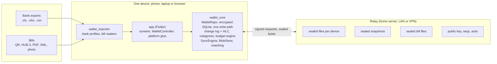

Every device runs the same code against the same relay. Nothing leaves a device unencrypted, and the relay cannot read
or forge anything.

### Components

| Component | Responsibility | Runs on |
|---|---|---|
| `app` (Flutter) | Screens, `WalletController` (caches derived values per data version), platform glue (file dialogs, camera, calendar, notifications, key storage) | Android, Linux, web |
| `wallet_importer` (pure Dart) | Bank export formats → `NormalizedTransaction`; bill readers (fiscal QR, HUB-3, UBL e-invoice, PDF text layer, free text) → `NormalizedBill`. The only code that knows file formats. | all, incl. web |
| `wallet_core` (pure Dart) | SQLite repo with one write path, field-level change log with hybrid logical clocks, categorizer, budget engine, matching, planned costs, bills, `SyncEngine`, `BlobStore`, encryption | all, incl. web (WASM SQLite) |
| `relay` (pure Dart server) | Stores sealed per-device files, snapshots and blobs; verifies Ed25519 signatures; prunes; enforces limits | home server (Podman image), LAN or VPN |

### Data flow

1. **In:** a bank file is picked through the system dialog, parsed in `wallet_importer`, and stored by
   `WalletRepo.importBatch`. Ids are deterministic (date + hash of date, amount, description + occurrence), so
   re-importing never duplicates. Bills follow the same shape: reader → `NormalizedBill` → `importBill`, with the
   original file sealed as a blob.
2. **Write:** every change (import, tap, setting) goes through `WalletRepo._write`, which updates the row, records a
   clock per field and queues an op in the outbox. Nothing writes tables directly.
3. **Derive:** categories, safe-to-spend, budgets, suggestions and the Upcoming list are computed at read from the
   stored rows; nothing derived is persisted, so a rule change or a sync shows on the next reload.
4. **Sync:** `SyncEngine` seals pending ops as this device's next numbered file and uploads it; then it fetches and
   applies the other devices' files strictly in order. Per field, the highest clock wins. Matching and transfer
   pairing run only once the device is caught up, so they never pair against rows still in flight.
5. **Out:** backups (`.bwb`, sealed), CSV exports, planned costs as `.ics`, logs: all through the system save dialog.
   No shared folders, no storage permission.

### Topology and failure behaviour

- Devices never talk to each other; each has one relationship: with the relay. Any number of devices; each writes
  only its own file sequence, so there are no write conflicts at the file level.
- Relay down: the app keeps working; the outbox grows; the next successful run sends everything. Relay wiped: every
  device notices its own files are gone and re-uploads its full state.
- A damaged or unreadable file from a peer is quarantined, reported, and the run continues with other devices; a
  caught-up device later writes a snapshot that lets the stuck device skip the damaged file.
- Snapshots every 7 days or 500 ops; the relay prunes files that both kept snapshots cover and every device seen in
  90 days has acknowledged. A new device starts from the latest snapshot, not from history.
- Web is a full client without sync (no relay client in the browser build by decision) and keeps the key wrapped by a
  passphrase.

## 5. System architecture

The architecture rests on one secret: the 32-byte **wallet key**, created on the first device and moved to others as
a `BW1-…` string or QR code. Everything else (database key, relay identity, signing key) is derived from it with
HKDF-SHA256 under distinct labels, so nothing needs to be stored or synchronised except the key itself.

### Keys and encryption

| Use | Derivation | Algorithm |
|---|---|---|
| Sync files, snapshots, backups, blobs | wallet key directly | XChaCha20-Poly1305; file = `BWOP1` \| 24-byte nonce \| 16-byte tag \| ciphertext of gzip(JSON ops) |
| Local database | HKDF(key, `bw-local-db-v1`) | SQLite3 Multiple Ciphers, raw 32-byte key, `PRAGMA key`; same on Android, Linux and web (WASM build) |
| Relay wallet id (`wid`) | HKDF(key, `bw-relay-id-v1`, 16 bytes) | 32 hex chars; the relay never sees the key |
| Relay signing | HKDF(key, `bw-relay-sign-v1`, 32 bytes) → Ed25519 seed | Public key stored by the relay on first use (TOFU) |
| Web key at rest | PBKDF2-HMAC-SHA256, 310,000 iterations, per-browser salt | Wraps the wallet key under the owner's passphrase; session unlock |
| Key at rest, phone | system keystore (`flutter_secure_storage`) | hardware-backed where available |
| Key at rest, desktop | private file in the app support directory | file permissions only |

### Local database

SQLite with one schema shared by all platforms (schema version 7). Synced entities: `tx`, `goals`, `goal_contrib`,
`wish`, `settings`, `merchant_rules`, `recurring`, `planned`, `bills`. Device-local tables (never synced, never in
backups): `clocks`, `outbox`, `sync_cursor`, `sync_files`, `meta`, `blob_cache`, `blob_outbox`, `blob_delete`, local
values (relay address, chosen calendars, `.ics` sources, nudge switches).

Migrations are additive (columns added, never renamed). Opening a database written by an older schema clears the sync
cursors once, so the device replays the relay history and picks up fields the old build ignored. A plaintext database
from an early build converts to encrypted on first open through a crash-safe side copy; a file the key cannot open is
set aside under a dated name, never deleted or merged.

### Change log and conflict resolution

$$\text{op} = \{\text{entity}, \text{id}, \{\text{field} \mapsto \text{value}\}, \text{hlc}\}$$

A hybrid logical clock (wall time, counter, device) stamps every write. Applying an op is idempotent and
order-independent: a field changes only when the incoming clock is newer than the stored one. Rows are created only
when some field applies; a wrong-typed field is ignored without recording its clock. Deterministic ids
(`rec:<payee>`, `calendar:<ref>`, `bill:<hash of externalId>`) let two devices that detect or import the same thing
converge on one row instead of two.

Design consequences a reviewer should know:

- Last-writer-wins per field, not per row: two devices editing different fields of one transaction both win.
- Goal totals are stored as contribution rows (deltas), not as a read-modify-write total, so offline additions on two
  devices both count.
- A device's clock far in the future is accepted as is (its writes win until real time catches up). Known limit.

### Relay protocol v2

HTTP, JSON for metadata, octet streams for files. Every request under `/v2/w/<wid>/` is signed: `X-BW-Sig` = Ed25519
over `bw-relay-v2\n<METHOD>\n<path>\n<X-BW-Covers>\n<sha256(body)>\n<X-BW-Time>`, window ± 5 min, client clock offset
learned from the relay's `Date` header and capped at 24 h. Full specification: `docs/context/RELAY_PROTOCOL.md`.

| Endpoint | Semantics |
|---|---|
| `GET state` | Per device: first and last seq, last seen, acks; current and previous snapshot; blob counts |
| `PUT d/<device>/<seq>` | Store a sealed file; never overwritten (same bytes 200, other bytes 409); no gaps (422); pruned (410); ≤ 16 MiB |
| `PUT ack/<device>` | What this device has applied of each peer; only grows |
| `PUT snapshot/<id>` | Full-state snapshot with `X-BW-Covers`; must dominate the current one |
| `PUT/GET/DELETE blob/<hash>` | Content-addressed sealed bill files; hash of body checked; counted toward the wallet byte limit |

Every mutating endpoint is idempotent or monotonic, so a replay inside the signature window changes nothing. Limits:
16 wallets, 1 GiB per wallet, 20 req/s per address, 32 MiB in flight per address. Storage is plain files plus a
`meta.json` per wallet with atomic writes; the relay rebuilds counts from disk on start.

### Sync engine

`SyncEngine.run` per trigger (start, resume, 3 s after a change, every 5 min, manual): read state → upload queued
blobs → upload outbox as `last + 1` (split into ≤ 8 MiB parts, outbox cleared only after every part is stored) →
apply each peer's files in order from its cursor → ack → if caught up: run matching and pairing once, write a snapshot
if due, self-heal a stuck peer after 24 h. First run on an empty relay uploads the full state. Transport is an
interface (`SyncTransport`) with an HTTP implementation and an in-memory one that enforces the same relay rules for
tests and simulations.

## 6. Code architecture and extensibility

The codebase is a Dart monorepo of about 23,500 lines of production code and 36,800 lines of tests, in 363 commits
since 2026-10-16. The layering is enforced by package boundaries, not by convention: the Flutter app depends on two
pure-Dart packages that cannot import Flutter, and the relay depends on neither.

### Packages and the dependency rule

| Package | May import | May not import | Holds |
|---|---|---|---|
| `packages/wallet_importer` | `archive`, `xml`, `logging` | Flutter, `dart:io` in the barrel, `wallet_core` | bank profiles, bill readers, own BIFF8/XLSX/CSV/PDF readers |
| `packages/wallet_core` | `wallet_importer`, `sqlite3/common`, `cryptography`, `http`, `archive` | Flutter; `dart:io`/`dart:ffi` only behind conditional exports (`*_io.dart` / `*_web.dart`) | repo, budget, matching, sync, blobs |
| `relay` | `cryptography` | anything from the app or packages | the server, ~1,200 lines |
| `app` | both packages, approved plugins | bank formats, money arithmetic | screens, controller, platform glue |

The `wallet_core` barrel compiles with dart2js and dart2wasm; a compile check (`tool/web_smoke.dart`) runs whenever an
import changes. This is what makes the web build a full client for free.

### Rules that hold the design together

1. **One write path.** `WalletRepo._write(entity, id, fields)` is the only way data changes; it updates the row,
   records clocks and queues the op. A new table or field is added to the entity map and schema; sync, snapshots and
   backups pick it up with no further code.
2. **No money logic in the app.** Calculations are pure functions in `wallet_core` (`computePeriod`, `budgetVsActual`,
   `upcoming`, `planMatches`, `planBillLinks`), unit-tested without a database; the app formats and displays.
3. **Pure, deterministic algorithms.** Matching, transfer pairing, bill linking and recurring detection are pure
   functions of their inputs with documented tie-breaks, so every device computes the same result and tests need no
   mocks.
4. **Platform splits by conditional import.** Every `dart:io` or plugin-bound capability sits behind a small
   interface with a native and a web (or "none") implementation: `key_store`, `wallet_db`, `log_backend`,
   `nudge_platform`, `calendar_source`, `bill_inputs`, `ics_fetch`. Only one file per capability imports the plugin;
   a test asserts that.
5. **Derived values cached per data version.** The controller bumps `dataVersion` on reload; screens never compute
   from raw transactions in `build()`. Pages are built once per data version and day, so a tab switch moves an
   `IndexedStack` instead of rebuilding.
6. **Shared lint and format.** One `analysis_options.yaml` at the root, infos fatal in CI, `dart format` at 140
   columns enforced.

### How a feature is added

Stage F (future spending) is the reference. The lead writes the core API first (`docs/context/FUTURE_SPENDING_API.md`:
types, repo methods, pure functions, settings), then four tracks run in parallel against it:

1. Core: entity + schema bump, repo methods, pure functions, two-device simulation tests.
2. Spec tests written from the API document, not from the implementation.
3. UI: screens, controller extension (a `part` file, e.g. `controller_future.dart`), widget tests at 320 dp × text
   2.0, 360 and 1280, against a temporary shim until core merges.
4. Review by a read-only reviewer on the full stage diff; every finding fixed with a test that reproduces it first.

A typical new entity costs: one entry in the entity map, one `CREATE TABLE`, a model class, repo methods through
`_write`, and pure functions. Sync, backup, snapshot, search hooks and schema replay come with it.

### Extension points already in place

| Want to add | Where | Effort |
|---|---|---|
| Another bank | `wallet_importer/lib/src/profiles/<bank>.dart` implementing `BankProfile` (detect, mapRow), registered in `bankProfiles`; new banks hash their profile id into transaction ids | small; golden tests prove existing ids unchanged |
| Another bill source (supplier portal, other barcode) | A reader returning `NormalizedBill` in `wallet_importer/lib/src/bills/` | small |
| Another sync backend | Implement `SyncTransport` (state, put, get, ack, snapshots, blobs); `MemoryTransport` is the reference | medium |
| Another platform capability | Interface + `_native`/`_web` pair, picked in a `*_platform.dart` | small |
| A new synced setting | Add to `WalletSettings` with validation; last writer wins | tiny |
| iOS / desktop ports | Flutter targets exist; platform glue (keystore, notifications, camera) needs per-platform implementations behind the same interfaces | medium |

### Observability

Structured log events (`bw.<area>`, `logEvent`/`logError`) with a hard privacy rule tested per package: counts,
durations, enum words and setting keys only; never amounts, descriptions, merchants, names, keys, paths or file names.
Logs rotate on device and can be exported from Plan › Diagnostics. A perf test in profile mode records frame timelines
with budgets.

### Debt a reviewer will notice

- `controller.dart` and `repo.dart` are large (controller split into `part` files per feature; repo is one class by
  design so `_write` stays private).
- Several thresholds are constants with tests rather than settings (matching window 3 days, recurring tolerance 10 %,
  heads-up defaults); the owner chose fixed values.
- No dependency-injection framework; fakes are injected through constructor seams (`forTest(clock:)`, `syncRunner`,
  `pdfParser`). Deliberate (no Riverpod, no code generation) and documented.

## 7. UI and UX

The interface follows one visual direction, **D3 Ledger**, chosen by the owner from ten drawn directions: a
paper-and-ink notebook with ruled sections, tabular figures and no cards, chosen because money reads best as a
ledger. The design system lives in `app/lib/src/theme.dart`; the spec is `docs/design/ledger-spec.md`.

### Design system

| Element | Decision |
|---|---|
| Type | IBM Plex Sans for text, IBM Plex Mono with tabular figures for every amount, weights 400/500/600 only; six unmodified font files (OFL, ~1 MB) |
| Colour | Paper `#f7f5ef` / ink `#1d2433`; night ledger (navy) follows the system setting; ink-blue accent; red only for negative or over-budget; all text pairs ≥ 4.5:1, non-text ≥ 3:1, checked by a contrast test |
| Money | `14 €`, `-23.40 €`, `+1,450.00 €`: sign in front, euro after a non-breaking space, mono, right-aligned, same right edge in a list |
| Surfaces | No cards, no shadows, radius 0–3; sections are ruled (1 px strong top rule, hairline bottom); totals carry a double rule; dialogs have a 1 px border |
| Buttons and inputs | Filled accent for the one primary action, outlined otherwise; inputs filled with a 1 px border, 2 px accent on focus, `€` suffix in mono |
| Wide windows | A red double margin line at x ≈ 22 from 600 dp, never on phones |
| Charts | Solid 1 px grid, bar radius 0, hatch for over budget, period in progress at 45 % with a dashed outline |

### Navigation and layout

Five destinations (Today, Spending, Wishlist, Goals, Plan) in a bottom bar on compact windows (< 600 dp) and a
`NavigationRail` from 600 dp. Content width is capped at 720 dp (medium) and 1040 dp (expanded, two columns on Today
and Spending). Sheets open as bottom sheets on phones and as 480 dp dialogs from 600 dp with no change to callers.
Keyboard: Ctrl+1–5 tabs, Ctrl+N add expense, Ctrl+F search, Ctrl+R sync. Pages keep their state across a resize.

### User flow

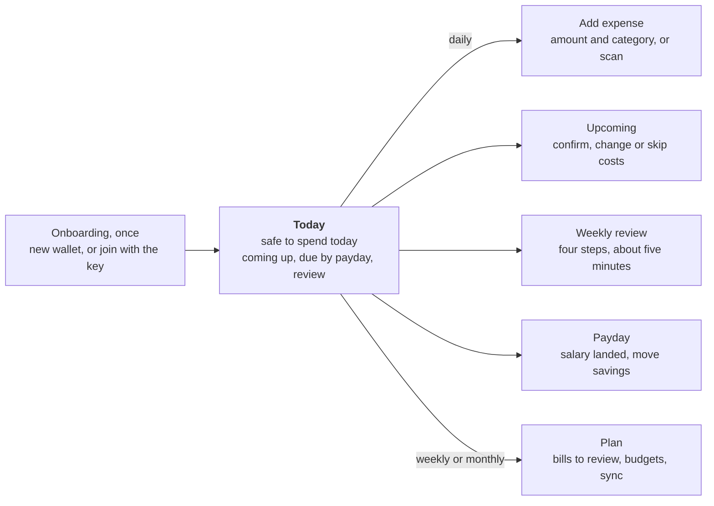

Every path starts at the safe-to-spend number and returns to it. Each action writes once; Today recomputes on return;
no number changes without a tap. The five actions on the right are the whole app for a daily user.

1. **Daily:** open Today → read safe-to-spend → "Add expense" (amount, category, note) or "Scan bill". Two taps for
   the common case.
2. **Weekly review** (Sunday by default): one screen, four ruled steps (import, confirm categories, pace, wishlist),
   each with a count and a tick; a streak counter rewards consistency.
3. **Payday:** "Salary landed: start new month" → checklist "pay yourself first" with goal amounts → "I moved N €".
4. **Bills:** scan or share → bill sheet in review with "Unsure" marks on guessed fields → Confirm (category required
   when a due date is set) → it reserves money until "Paid by…" links the bank row.
5. **Upcoming:** month grid of the pay period with marks per kind (planned, bill, suggested, warranty, return-by) and
   a ruled list below; calendar suggestions need one tap to confirm.

### Screens as built

Screenshots from the automated runs of 2026-10-22 on the Android emulator (1080 × 2400, light theme) and the Linux
desktop (1280 × 720), with a synthetic demo wallet (`docs/spec/screens/`). The same frames land in `dist/screens/`
after `tools/emulator.sh screens` and `tools/build.sh desktop-test screens`.

| | |
|---|---|
| 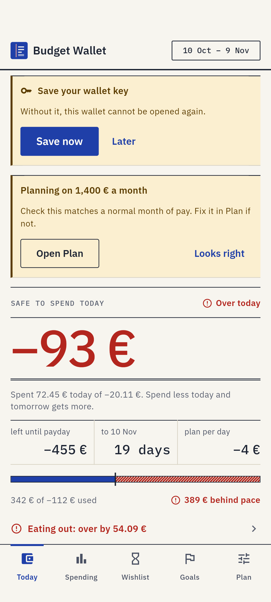 | 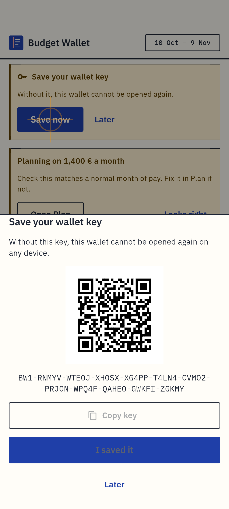 |
| **Today.** The number first, then what will change it: coming-up costs, a review that is due, the payday checklist. One primary button. | **Key prompt.** Stays on Today until the owner confirms the key's last four characters; "Later" hides it for seven days. |
| 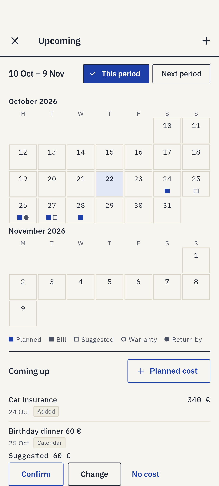 | 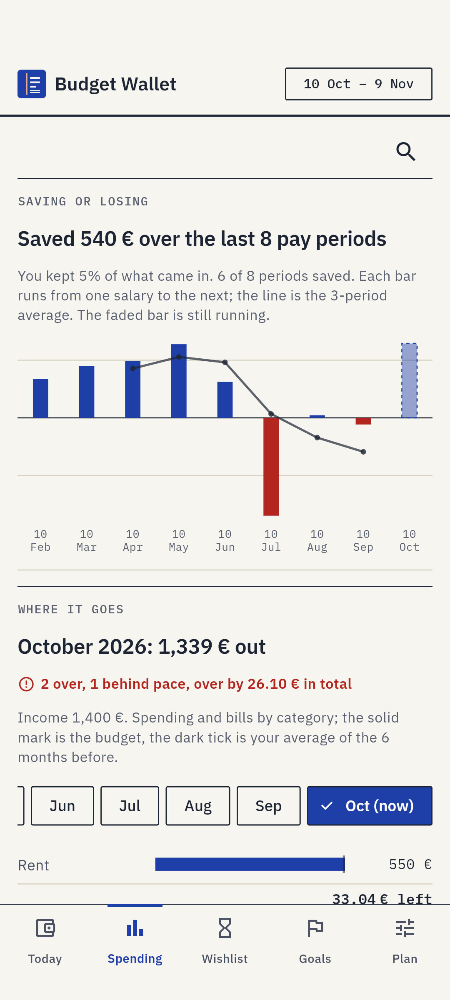 |
| **Upcoming.** The pay period as a grid, marks by kind, the list below. A calendar event with a suggested amount needs one tap to count. | **Spending.** Saved or lost per pay period, then where the month went against budgets and the six-month average. |
| 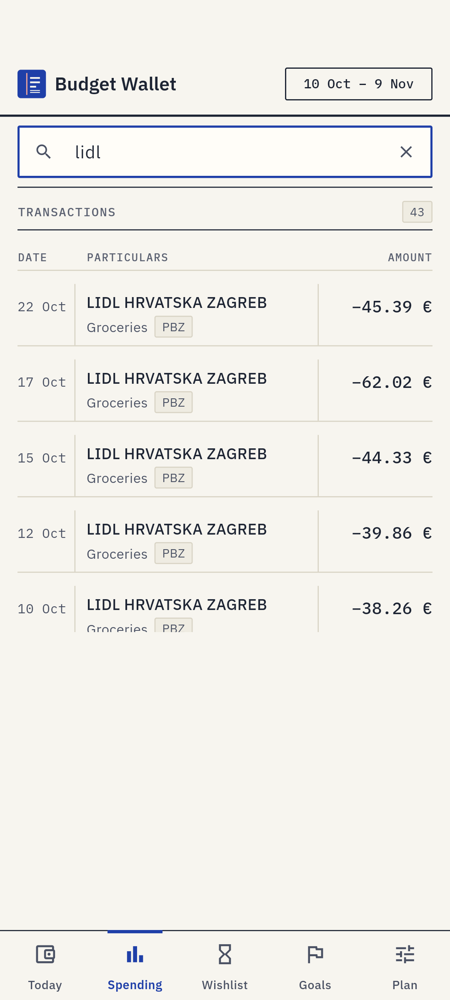 | 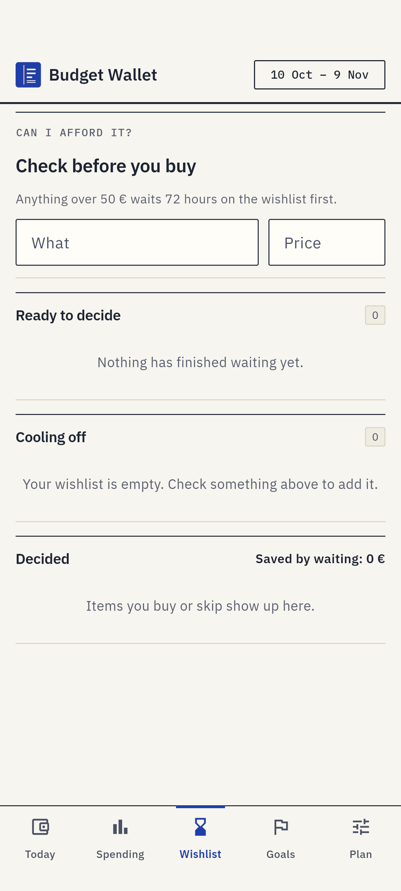 |
| **Search** replaces the page in place; the page keeps its scroll when search closes. | **Wishlist.** Anything over 50 € waits 72 hours; "saved by waiting" is the reward. |
| 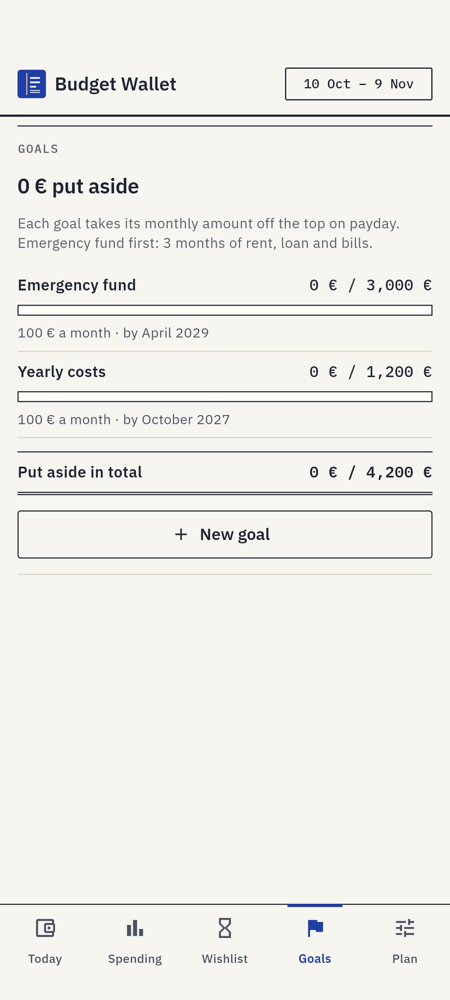 | 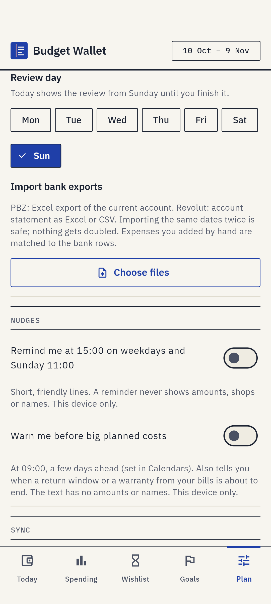 |
| **Goals.** Ruled rows and a total; contributions are paid from the payday checklist. | **Plan › Expected bills.** Detected from bank history; nothing is reserved until the owner confirms it. |
| 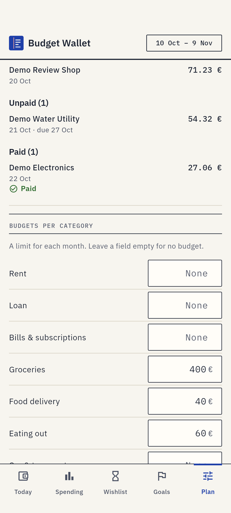 | 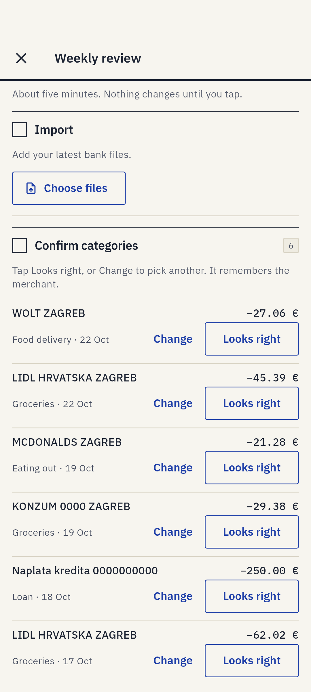 |
| **Plan › Bills.** Three lists; a bill in review does not count anywhere yet. | **Weekly review.** "About five minutes. Nothing changes until you tap." Each row is one decision. |

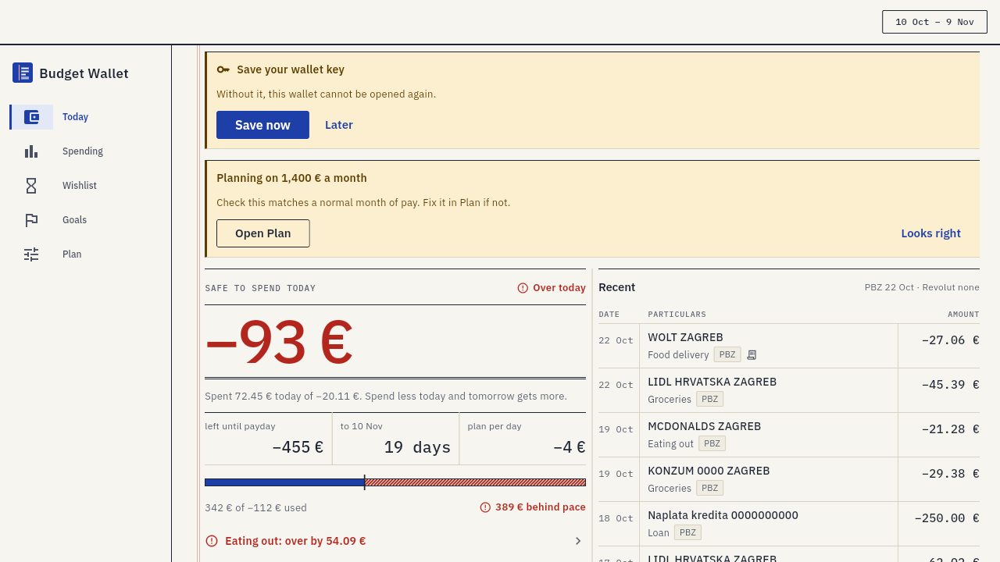

Desktop from 600 dp: a rail, two columns on Today and Spending, the notebook margin line. The demo wallet is over
budget today, so the hero is red and the bar hatched.

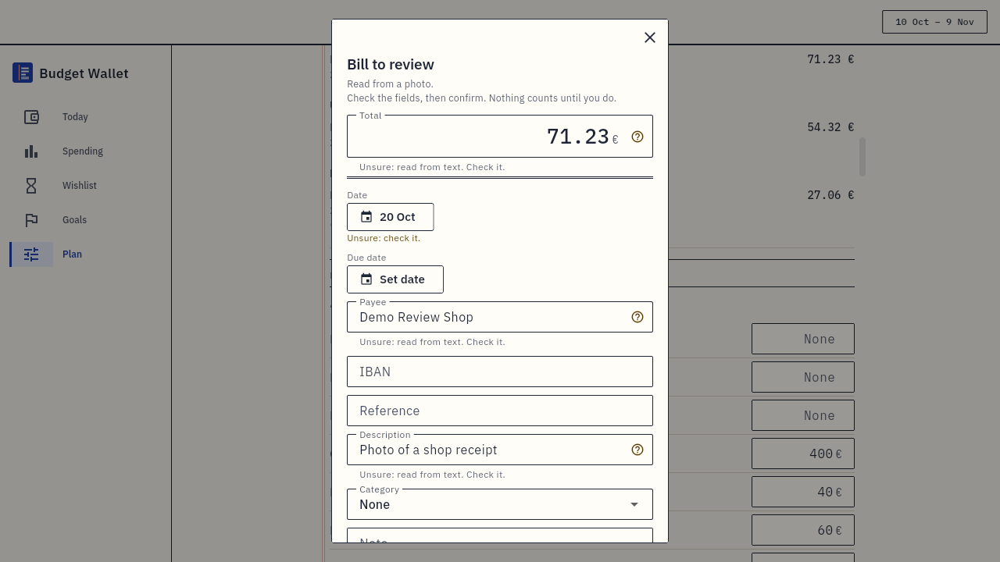

The bill sheet that is a bottom sheet on the phone opens as a 480 dp dialog on the desktop; fields read from a photo
carry an "Unsure" mark until checked.

### Accessibility and robustness

- Every screen is tested at 320 dp with text scale 2.0, at 360 dp and at 1280 dp, in light and dark, with the real
  fonts loaded; overflows fail the test.
- Marks in Upcoming differ by shape as well as colour; income is signed `+` as well as coloured.
- Minimum touch targets 44 dp; rail items at least 44 dp; no gesture-only actions.
- Notifications never carry amounts or names (lock-screen safety); the key is shown as plain text, never selectable,
  and the clipboard is cleared after 60 s.
- Screenshots of every tab on the Android emulator and Linux desktop are produced on every stage run and read before a
  push; no golden-image tests, structural widget tests pin behaviour.

### Try it hands-on

| Way | Command or source | What you get |
|---|---|---|
| Linux window with demo data | `tools/live.sh start --demo` (Podman on a Linux host) | The real app in a window with a synthetic wallet: planned costs, bills, calendar suggestions; hot reload; `tools/live.sh shot` for screenshots |
| Android emulator | `tools/emulator.sh screens` | Boots an emulator, runs every tab with the demo wallet, saves `dist/screens/*.png` |
| Web in a browser | `tools/build.sh web && tools/web.sh serve` → `http://127.0.0.1:8080` | Onboarding, new wallet with a passphrase, import a synthetic export from `packages/wallet_importer/test/fixtures/` |
| Phone | Signed APK from the `dev` GitHub release (built when the owner runs the `ci` workflow) | Full app incl. camera scan, OCR, share-to-app, notifications |
| Desktop bundle | `tools/build.sh linux` → `dist/` | Release build without demo data |

### Open UX questions for the reviewer

- Plan is a long single scroll of ruled sections; a grouped settings index may read better as sections grow.
- The web build has no sync; the Sync section is hidden there, but "same wallet everywhere" has one exception to
  explain.
- Camera scan, OCR and share-to-app have only been exercised through fakes and the emulator; the owner's phone test is
  the first real use.

## 8. Feature parity with similar apps

Budget Wallet sits between the envelope budgeters (YNAB, Actual Budget) and the self-hosted finance trackers (Firefly
III): it has the daily "what can I spend" of the first group and the data ownership of the second, plus a
bills-with-documents layer none of them ship. It deliberately lacks bank connections and multi-user features. The
comparison is from the products' public feature lists as known in mid-2026 and has not been re-verified for this
document; treat it as approximate.

| Capability | Budget Wallet | YNAB | Actual Budget | Firefly III | Monarch | Bank app (typical) |
|---|---|---|---|---|---|---|
| Daily safe-to-spend from a payday plan | Yes, the core number | Age of money, category balances | Category balances | No | Cash-flow forecast | Sometimes a monthly view |
| Bank data | File import (PBZ, Revolut), deterministic ids | Direct import (US/CA/UK), file import | Direct (SimpleFIN/GoCardless), file | Direct (Nordigen/Salt Edge), file | Direct (Plaid) | Own accounts only |
| Recurring bills detected and reserved | Yes, owner confirms, reserved until paid | Scheduled transactions | Schedules | Bills + rules | Recurring detection | Standing orders |
| Planned costs from calendar events | Yes, device calendars + `.ics`, suggested amounts | No | No | No | No | No |
| Bills with documents (receipt QR, slip barcode, PDF, OCR) | Yes, line items, encrypted file storage, warranty/return reminders | No | No | Attachments on transactions | No | Some (e-bills) |
| Multi-device sync | Self-hosted relay, E2E encrypted, offline-first | Cloud | Self-hosted server or cloud, E2E option | Self-hosted server | Cloud | Cloud |
| Local data encryption | Encrypted SQLite, key derived from wallet key | n/a (cloud) | Optional | Server-side | n/a | n/a |
| Goals / sinking funds | Goals with deadlines, paid once per period | Targets | Goals (templates) | Piggy banks | Goals | Savings pots |
| Wishlist with cooling-off | Yes, 72 h, affordability from safe-to-spend | No | No | No | No | No |
| Weekly review habit | Guided 4-step review, streak | Reports | Reports | Reports | Review emails | No |
| Budgets per category with pace | Monthly, 6-month average suggestions, pace vs. month elapsed | Core feature | Core feature | Budgets | Budgets | Spending caps |
| Rules / categorisation | Importer hints + merchant rules learned on tap, never amount-based | Payee rules | Rules | Rules engine | Rules | Merchant category |
| Platforms | Android, Linux, web (localhost) | iOS, Android, web | Web, desktop (Electron), mobile PWA | Web (self-hosted) | iOS, Android, web | iOS, Android |
| Multi-currency | Single currency (EUR), exchange rows handled as transfers | Yes | Yes | Yes | Yes | Yes |
| Shared household users | Single wallet, any number of the owner's devices | Shared plans | Shared servers | Multi-user | Household | Joint accounts |
| Price | Self-hosted, free | Subscription | Free, open source | Free, open source | Subscription | Free |

**Ahead:** the combination of a payday-based daily number, reserved future costs and the owner-confirms rule produces
a single trustworthy figure; bill ingestion from Croatian fiscal receipts (JIR) and HUB-3 slips with line items and
encrypted document storage has no equivalent in general-purpose apps; end-to-end encryption with a relay that stores
only ciphertext and a public key, including the bill documents.

**Behind:** no bank connection (history arrives by file export, so the weekly review includes an import step); single
currency and single household; two bank formats; no reports beyond the Spending view and CSV export; Android only on
mobile.

## 9. Security and privacy

The security goal is narrow and testable: **nobody but the holder of the wallet key can read or change the owner's
financial data, and no third party is in the loop.** The relay, the network, the repository and the logs are all
designed to be safe to expose.

### Threat model

| Adversary | Can see or do | Cannot |
|---|---|---|
| Network sniffer on the LAN (plain `http://` to the relay) | Wallet id, device ids, sequence numbers, sizes, times, sealed bytes; replay a request unchanged within 5 min (idempotent, so no effect); block or delay sync | Read content, forge or alter files, ack, prune or delete anything, learn the key |
| Someone who controls the relay or steals its disk | Everything above plus: drop, withhold, roll back or delete files and blobs; lie in the state | Read, forge or alter sealed content; sign requests to another relay; derive the key |
| Someone who wipes the relay before the owner reconnects | Squat the wallet id with their own public key (devices then get 401: denial of service) | Read anything; the owner points devices at a fresh relay and they re-upload |
| Someone with the phone unlocked | Use the app | Export the key without seeing the "Show wallet key" screen; read the database file from another app (sandbox + encryption) |
| Someone with a laptop image or a stolen disk | Read the key file in the app support directory (desktop: file permissions only) | — see known limits |
| A malicious bill file or calendar file | Attempt parser abuse | Crash or hang the app: readers never throw, have size caps, inflate caps, step and op budgets; XML external entities and DOCTYPE are refused; PDF text runs off the UI isolate |
| Repository reader (code is on GitHub) | Read all code, tests, synthetic fixtures | Learn any real figure: fixtures are generated; personal numbers live only in the owner's wallet |

### Cryptography

- **Content:** XChaCha20-Poly1305 (via `package:cryptography`), fresh 24-byte nonce per file, 16-byte tag; the magic
  `BWOP1` precedes the nonce. Same construction for sync files, snapshots, backups and bill blobs.
- **Key derivation:** HKDF-SHA256 with empty salt and distinct info strings (`bw-local-db-v1`, `bw-relay-id-v1`,
  `bw-relay-sign-v1`); the wallet key itself is 32 random bytes from the platform CSPRNG.
- **Request authentication:** Ed25519 signatures over method, path, covers header, body SHA-256 and time; ± 5 min
  window; the relay stores the public key on wallet creation (trust on first use) and verifies every later request
  with it. The signed text is specified byte-for-byte in `docs/context/RELAY_PROTOCOL.md`; the relay's tests use a
  hand-written signer from that text, not the client library.
- **Local database:** SQLite3 Multiple Ciphers with a raw 32-byte key (no KDF inside SQLite), WAL disabled during
  rekey, crash-safe conversion with a side copy that is deleted after verification.
- **Web:** the key is wrapped under PBKDF2-HMAC-SHA256 (310,000 iterations) with a per-browser salt; the unwrapped
  key lives in session memory; "Forget this browser" wipes it. Database in IndexedDB through the same encrypted VFS.

### What leaves the device

Only to the owner's relay: sealed files, sealed snapshots, sealed blobs, the wallet id, device ids, sequence numbers,
acks, signatures and the public key. Nothing to any other host. `.ics` links the owner adds are fetched from the host
they name (60 s cap, 2 MB cap, https never downgraded, an `http://` link shows a warning). There is no analytics, crash
reporting or update check.

### Permissions (Android)

| Permission | Why | When asked |
|---|---|---|
| INTERNET, cleartext traffic | Relay on LAN/VPN by IP, `.ics` links | install |
| POST_NOTIFICATIONS | Nudges, heads-ups, bill reminders | when the owner turns nudges on |
| RECEIVE_BOOT_COMPLETED | Re-schedule notifications after reboot | install |
| READ_CALENDAR, WRITE_CALENDAR | Read device calendars; WRITE is declared because the plugin's permission request needs the whole group; the app never writes (reviewed and tested) | when the owner taps "Allow calendar access" |
| CAMERA | Scan bill | when the owner opens Scan bill |
| No storage permission | All files go through the system picker and save dialog | — |

### Privacy in logs and fixtures

A log line may carry counts, durations, sizes, dates, built-in category names, setting keys and enum words. It may
never carry amounts, descriptions, merchants, notes, goal or wish names, payees, IBANs, references, titles, calendar
names, the key, device ids, paths, file names or hashes. Each package has a test that scans every log line produced by
its features for synthetic secrets. Notifications follow the same rule. All test fixtures are generated by
`tools/make_fixtures.py` (fictional payees, IBANs with valid checksums from unassigned bank codes, random JIRs).

### Supply chain and build

Flutter version pinned in `pubspec.yaml` and read by CI; `sqlite3.wasm` pinned by SHA-256; dependencies limited to a
short approved list (every new package needs the owner's decision; three added for bills in October 2026). Release
APKs are signed with one fixed key kept outside the repository; CI never falls back to debug signing. CI runs only when
the owner starts it. Builds are reproducible in a rootless Podman image.

### Known security limits

1. **Desktop key at rest** is a private file, not a keystore; a stolen unencrypted laptop disk exposes the key.
   Mitigation: full-disk encryption on the laptop (outside the app).
2. **Relay over plain HTTP** exposes metadata (who syncs, when, how much) and allows denial of service by anyone on
   the network; the recommended setup is a VPN (WireGuard) or a TLS reverse proxy.
3. **TOFU on wallet creation:** a wiped relay can be squatted before the owner reconnects (denial of service only).
4. **Losing the key loses everything** by design; the app prompts once to save it in a password manager and nags on
   Today until the owner confirms the last four characters.
5. **Clipboard:** the key is cleared after 60 s, but a clipboard manager may have kept a copy.
6. **Android backup:** the database is encrypted, but `allowBackup` settings and the keystore's behaviour across
   device migrations have not been audited.
7. **`WRITE_CALENDAR` is declared** although unused; a reviewer may want a plugin that asks for read only.

## 10. Quality: tests, review and performance

The test code (36,800 lines) is larger than the production code (23,500 lines). Every stage ends with one full
verification on the owner's laptop before a push; CI exists for the signed builds and runs only on request.

### Test counts (2026-10-22, local full run)

| Suite | Tests | What it covers |
|---|---|---|
| `wallet_importer` | 295 | Bank profiles with golden outputs (ids unchanged since v1), BIFF8/XLSX/CSV edge cases, fuzzing, bill readers incl. 500 mutated PDFs/XMLs, log privacy |
| `wallet_core` | 1,177 | Money maths, categorizer, matching and pairing, recurring detection, planned costs, bills, encryption, local DB conversion, sync engine over an in-memory relay, two-to-four-device random convergence, quarantine, snapshots, self-heal, backup round trip, relay client with hand-written signatures, end-to-end against the real relay |
| `relay` | 138 | Every endpoint, signature and clock rules, replays, limits, pruning, restart recovery, blobs, CORS, logs; the binary as a process |
| `app` (widget) | ~940 | Every screen at 320 dp × 2.0 / 360 / 1280, light and dark, controller logic with fakes, theme contrast, log privacy, platform splits |
| Desktop integration (Linux, Xvfb) | 11 files | Onboarding, flows, import, layout (5 shards), plan, relay sync against a real relay, screens, wishlist/goals, big wallet, perf, adaptive |
| Android emulator | 1 file | Every tab with a synthetic wallet, screenshots, log scan |
| Web | 9 + build | `flutter test --platform chrome` for the browser key store, DB and unlock; wasm build |
| Perf (profile mode) | 2 actions | Spending scroll and tab switches on a 20,000-row wallet |

Spec tests are written by a separate agent from the API document before the implementation exists; the implementation
then has to satisfy them. For the bills stage that was 150 tests; 7 were adjusted after discussion and listed with
reasons.

### Performance budgets

| Metric | Budget | Measured (software GL under Xvfb) |
|---|---|---|
| Frame build p90 | 8 ms | 1.2 ms |
| Frame build max | 32 ms | 14.6 ms |
| Raster p90 | 40 ms | 5.0 ms |
| Missed build frames | ≤ 5 | 0 |
| Startup with 20,000 rows | not budgeted | pages built once per data version; derived values cached |
| Relay signature | — | ~1.8 ms per request on the VM |
| `.ics` parse, hostile 2 MB file | < 10 s (test bound) | ~1 s |

### Review process

Every stage: scout (context pack) → builders in worktrees against a fixed API → spec tests in parallel → merge →
read-only reviewer on the full diff (money, sync safety, privacy, brief match) → each finding fixed with a reproducing
test → full run → screenshots read → push. Review outcomes so far: Stage R 0 high / 3 medium / 5 low; Stage S 0 / 1 /
4; Stage F 2 / 3 / 5; Stage B 3 / 4 / 3. All fixed before push.

### Build and CI

`tools/build.sh test|lint|desktop-test|perf|web|apk|linux` runs the same steps as CI in a rootless Podman container
with the pinned Flutter. Timings per step and per test are kept in a local history with medians and trends. CI
(`ci.yml`, manual): lint, package tests, desktop tests on request; signed APK (arm64, 44 MB), Linux bundle with a
headless smoke test, dev release; logs merged to a `ci-logs` branch.

## 11. Known limits and open questions

Documented in `docs/context/STATUS.md` and the package notes; either accepted by the owner or waiting for the live test.

### Money and matching

- A hand-added expense whose bank row posts more than 3 days later keeps counting until the owner links it by hand
  (fixed window, owner decision 2026-10-22).
- The same export imported on two devices before they sync: the later import's clock wins, so a cash entry added in
  between on the first device can be matched to that row although that device held it.
- A confirmed recurring bill whose payment moves by more than 10 % or 3 days stays reserved as overdue until the owner
  skips, dismisses or re-confirms it.
- A planned cost whose bank row already landed reserves until marked paid or its date passes (the app suggests "Paid
  by this?").
- Two calendar events with the same name on the same day show as one suggestion; renaming an event suggests it again.
  A title with no letters (`80 €`) gets a per-calendar ref, so its dismissal does not reach other devices.
- A bill linked to a hand-added expense stays paid after matching replaces that entry with its bank row.

### Sync

- A device stays stuck on a damaged file only if no caught-up device that applied it before the damage still syncs.
- A wiped relay plus a peer that re-uploaded more files than the old cursor before this device syncs: the cursor is
  trusted and the files between are skipped (seq numbers carry no relay identity).
- Mixed versions: older builds ignore entities they do not know and replay once on upgrade; upgrade all devices
  together.
- Blobs: the same bill imported with a file on two devices before a sync leaves one orphan upload until the next
  caught-up run cleans it; deleted bills' files stay in other devices' caches until their next caught-up run.

### Platform

- Web has no sync and no notifications by decision; one tab at a time.
- iOS, Windows and macOS builds exist from an early release but are unmaintained.
- Camera, OCR, PDF rendering and share-to-app are compile-proven and tested with fakes; first real use is the owner's
  phone test.
- The APK is 44 MB (arm64 only) because the barcode and text-recognition models are bundled for offline use.

### Open questions for the owner

- Make the repository public? (Free CI minutes for all platforms; nothing private is in it.)
- A separate switch for bill reminders, or keep them under the heads-up switch?
- Replace the calendar plugin with one that declares read-only access?

## 12. Roadmap and extension candidates

The next step is fixed: the owner's live test (M6) on phone and laptop with the checklist in `docs/context/STATUS.md`.
Everything after it depends on that test and on this review. Candidates, in the order they would be cheapest to add:

| Candidate | Why | Fits where |
|---|---|---|
| More bank profiles | Each is one file with golden tests | `wallet_importer/profiles` |
| Column mapping for unknown layouts | Lets the owner map a new export once, saved as a synced setting | importer + a Plan sheet |
| TLS for the relay (built-in or documented reverse proxy) | Removes the plain-HTTP metadata and DoS exposure without a VPN | `relay` + `docs/setup.md` |
| Desktop key in a keyring | Closes the biggest known security limit | `key_store_io.dart` |
| Reports (net per month, category trends over a year) | Common parity gap; pure functions over existing rows | `wallet_core/budget.dart` + a screen |
| Multi-currency amounts on rows | Revolut exchanges already carry a hint; budgeting would stay in EUR | importer hint + display |
| Supplier portals for bills | Another reader returning `NormalizedBill` | `wallet_importer/bills` |
| iOS | Flutter target exists; keystore, notifications, camera and share need iOS glue behind the same interfaces | `app` platform files |
| Shared household wallet | Would need per-user identity in ops and a permission model; the largest change | not in the current design |

Dropped by decision and kept only for reference: research projects and ongoing trackers.

## 13. Reviewer checklists and glossary

Each list names what the author believes a reviewer in that discipline should test the claims of this document
against.

### System design

- [ ] The offline-first model holds: can every feature be used with the relay down?
- [ ] Failure behaviour in §4 (relay down, wiped, damaged file, stuck device) matches the tests in `sync_*_test.dart`.
- [ ] The single-owner, many-devices assumption is explicit everywhere it matters.

### UI/UX

- [ ] The daily flow (Today → add expense) is two taps; the weekly review fits in five minutes.
- [ ] Ledger tokens and contrast hold in light and dark at text scale 2.0 (screenshots in `dist/screens/`).
- [ ] "Suggest, the owner confirms" is visible in the UI wherever a number is guessed (Unsure marks, suggestion chips).
- [ ] Plan's long scroll and the web "no sync" exception are acceptable.

### System architecture

- [ ] HKDF labels, file format and signed text match `RELAY_PROTOCOL.md` and `vault.dart`.
- [ ] Last-writer-wins per field is the right conflict rule for every entity (goal contributions as deltas is the one
      exception by design).
- [ ] Snapshot and pruning rules cannot lose an op that some device has not applied.

### Feature parity

- [ ] The comparison table in §8 is fair to each product; mark cells you know to be wrong.
- [ ] The listed gaps (no bank connection, single currency, Android only) are acceptable for the intended user.

### Code architecture and extensibility

- [ ] The package dependency rule is enforced (try importing Flutter in `wallet_core`).
- [ ] Adding a bank profile and a synced setting is as small as §6 claims.
- [ ] Constructor seams give enough testability without a DI framework.
- [ ] The large `repo.dart` and `controller.dart` are navigable.

### Security

- [ ] Threat model in §9 covers the deployment the owner runs (LAN, VPN or TLS proxy).
- [ ] Nonce reuse is impossible (fresh random nonce per seal; same plaintext sealed twice gives different hashes,
      tested).
- [ ] TOFU on wallet creation and the 24 h clock-offset cap are acceptable.
- [ ] Desktop key at rest, clipboard and Android backup behaviour are tracked as limits.
- [ ] Parsers on hostile input: size caps, budgets, no exceptions (fuzz tests in `bills_test.dart`, `ics_spec_test.dart`).
- [ ] Log privacy tests cover every new log event.

### Glossary

| Term | Meaning |
|---|---|
| Wallet key | The 32-byte secret everything derives from; shown as `BW1-…` text or QR |
| Pay period | From the day the salary lands to the day before the next one |
| Safe to spend | Flexible money minus spent and reserved, divided by days left |
| Reserved | Money set aside for confirmed bills and planned costs before payday |
| Covered by your plan | A cost in a fixed category (rent, loan, subscriptions) already in the payday plan: listed, never reserved twice |
| Op | One change: entity, id, fields, hybrid logical clock |
| HLC | Hybrid logical clock: wall time, counter, device; orders ops across devices |
| Sealed | Encrypted with XChaCha20-Poly1305 under the wallet key |
| Relay | The owner's home server that stores sealed files and verifies signatures |
| Snapshot | A sealed full-state file that lets a device skip history |
| Caught up | A device has applied every peer's files through their last seq; only then does it match and pair |
| Matching | Linking a hand-added expense to the bank row that is it (same amount, ± 3 days, bank row unseen when added) |
| Pairing | Linking two own-account transfer rows (needs a bank hint on one side) |
| Planned cost | A future expense with a date, reserved before payday once it has a confirmed amount |
| Bill | A document (receipt, slip, invoice) with totals, line items, a sealed file and an optional due date |
| Blob | A sealed bill file on the relay, addressed by the hash of its sealed bytes |
| HUB-3 | The Croatian payment-slip 2D barcode (PDF417) carrying payee, IBAN, amount and reference |
| JIR | The unique id on a Croatian fiscal receipt, found in its QR code |
