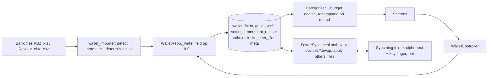
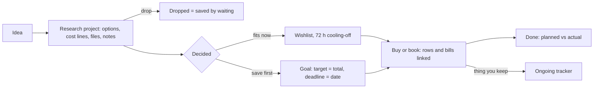

# Budget Wallet — design decisions and proposals (2026-10-19)

Condensed from today's planning session (claude.ai). Put this file at `docs/context/DESIGN_DECISIONS.md`.
All numbers below are made-up samples. No personal figures. "Proposed" = not built and not scheduled yet.

## Links (private, owner only)
- Design system "Budget Wallet": https://claude.ai/artifact/5tQpueayHHhYY3cgP9jw4q
- Doc "App Data Flow": https://claude.ai/code/artifact/fc2bf022-bfed-4be0-a0cd-944075d7fd91
- Doc "Features and User Flow": https://claude.ai/code/artifact/cfa7c0a1-e014-4e9e-9b73-4116942b9508
- Design canvas "10 Directions" (pages Kept / Parked): https://claude.ai/artifact/Vfy7FfEXoXVDKAJgYG4NKU

## 1. Decisions
| Date | Decision |
|---|---|
| 2026-10-19 | Money format: euro sign AFTER the amount with a non-breaking space: `14 €`, `-23.40 €`, `+1,450.00 €`. Sign stays in front. Amount fields show € as a suffix. Design system updated; **app `format.dart` still puts € first: change it.** Decimal point and thousands comma unchanged (Croatian `1.250,00 €` not decided). |
| 2026-10-19 | Screen design: 10 directions × 12 screens drawn. **Kept:** D1 Baseline (current Material 3), D3 Ledger, D5 Soft Blocks, D6 Receipt, D8 Calendar, D10 Voice First. **Parked:** D2 Night Shift, D4 Swiss, D7 Cockpit, D9 Editorial. Final pick still open. |
| 2026-10-19 | D8 Calendar carries the new feature "calendar integration and future spending" (screen `d08-Upcoming`). |
| 2026-10-19 | Projects live under the **Goals** tab (views: Goals / Projects). Five tabs stay. |
| 2026-10-19 | **Final direction: D3 Ledger** (owner). Built after the adaptive layout: its tokens go into `theme.dart` and the design system. |
| 2026-10-19 | Ledger details (owner): dark mode = navy "night ledger" following the system; six unmodified IBM Plex fonts (~1 MB); red margin line only on wide windows. Spec: `docs/design/ledger-spec.md`. |

- 2026-10-20: **Money is never reclassified on amount alone.** A transfer between own accounts needs bank evidence (kind hint from the importer profile, or a rule the owner set); equal amounts across banks are not evidence. Applies to every future heuristic.

- 2026-10-20: Budget vs actual per category (§4.5) approved: **monthly** budgets (calendar month, like the chart), prefilled from the 6-month average on request, "left" line on Today. The two matching/sync known limits (lagging-device cash match, damaged-file double count) are solved in the sync redesign, not before.

- 2026-10-20: M4 Habits (§4.6) approved: review day Sunday by default, changeable per user; confirmed recurring bills **reduce safe-to-spend** until paid (reserved money is not spendable); nudges at 15:00 weekdays and Sunday 11:00; `flutter_local_notifications` allowed; notification text = funny, encouraging words only, never amounts.
- 2026-10-20: `v2` merged into `master` (owner).

## 2. Data flow as built (v2) — summary

- One write path (`_write`), categories and all numbers computed at read, per-field last-writer-wins by HLC.
- Safe today = (flexBudget − spent before today) ÷ days left − spent today; flexBudget = income − (rent+loan+subs) − Σ goal monthly.

**Gaps found (fix order):**
1. Goal `saved` is read-modify-write → lost update across offline devices. Store contributions as rows, sum at read.
2. One bad `.bwop` file stops the whole sync run. Quarantine it, continue, report the device.
3. Sync is tied to `dart:io` folders. Add a transport interface (put / list new / get); folder = one implementation.
4. Sync files kept forever; new device replays all. Periodic snapshots + pruning of files all devices applied.
5. Hard-coded thresholds: hand-entry match (same amount, ±3 days) → synced setting. (Rent cash threshold already fixed.)
6. Local `wallet.db` not encrypted (only sync files are). Decide: accept or encrypted SQLite.
7. Key has no backup path. Prompt once to save `BW1-…` in a password manager.
8. PBZ/Revolut hard-wired in core and app; identical rows from two banks would collide on id (see 4.1).
Watch: reload re-categorizes every transaction on each change/sync (`wc.reload` timing).

## 3. Web version — what must change
Pure Dart and fine on web: importer, budget maths, categorizer, HLC merge. Needs a web twin behind conditional imports:
| Part | Problem | Web replacement |
|---|---|---|
| `repo.dart` | native `sqlite3.open(path)` | `sqlite3` WASM build (OPFS/IndexedDB) |
| `controller.dart` | `getApplicationSupportDirectory`, `File` | database name, no path |
| `sync.dart` | `Directory`/`File`, no Syncthing in browser | transport interface; relay storing the same `.bwop` ciphertext |
| `vault.dart` | `gzip` from `dart:io` | `archive` gzip (pure Dart); XChaCha20 from `cryptography` already works |
| `key_store.dart` | keystore / private file | session-only key or passphrase-wrapped |
| `logs.dart`, `logging.dart` | rotating files | in-memory buffer + download |
| `storage_access.dart` | Android-only | not needed |
Order: transport interface + `archive` gzip first, then WASM DB + web key store, then relay.

## 4. Proposals (not built)

### 4.1 Other banks — bank profiles
- One `BankProfile` per bank in `wallet_importer` (id, label, detect(first rows), mapRow, skip rules); registry tries each.
- Contract additive: `NormalizedTransaction.kindHint` (card, atm, salary, fee, standingOrder, ownTransfer, other) and `account`.
- Categorizer reads only `kindHint`; profile cleans merchant names. No bank names in core or app (labels from profile).
- New banks hash `source` into the id; PBZ/Revolut keep v1 ids.
- Own-transfer rule (as built 2026-10-20, replaces the earlier amount-only idea): a pair needs a bank-hinted side (`kindHint` ownTransfer: Revolut top-up, PBZ payment to Revolut) plus the equal opposite row in another source within 3 days; two unhinted rows never pair; currency exchanges never pair. Equal amounts alone are not evidence (decision 2026-10-20).
- Unknown layout → map columns once, saved as synced setting keyed by header row.
- First step: move PBZ and Revolut into profiles with tests proving ids and categories unchanged.

### 4.2 Bills database (source-agnostic)
- Sources → readers → one `NormalizedBill` → `importBill()`; app never sees QR/barcode/XML.
- Readers: fiscal receipt QR (date-time, total, JIR), HUB-3 2D barcode on slips (payee, IBAN, amount, model+reference, description), e-invoice XML (UBL / EN 16931), PDF text layer, OCR fallback; later supplier portals.
- Inputs: camera scan (Add expense › Scan bill), file import (Plan), inbox folder (automatic, lands in "To review").
- `NormalizedBill`: source, externalId (JIR / invoice no / reference, unique → dedupe), date, total cents, currency, payee, optional IBAN, reference, dueDate, items, original file hash.
- Link to bank row: by reference (JIR / invoice no / payment reference) found in the bank text; otherwise the bill stays "unlinked" for the owner to link by hand (never by amount alone, decision 2026-10-20). Photos/PDFs stored once as encrypted files in the sync folder, fetched by hash.
- Open: totals only or line items? keep photo or data only? warranty/return reminders?

### 4.3 Calendar integration and future spending
- Planned costs from: calendar events given an amount, bills with due dates, recurring bills found in exports, manual entries, project cost lines and schedules.
- Safe to spend = (flexible money − spent − planned before payday) ÷ days left. Sample: 92 € planned → 14 € becomes 10 €. After-payday costs go into the next period.
- Real bank row / hand entry for a planned cost replaces it (no double counting). Learned amounts are only suggestions until confirmed.
- Only events given an amount are stored (title, date, amount), synced encrypted. Android calendar provider; Linux/web via .ics.
- UI: "Coming up" line on Today; Upcoming screen (pay period as calendar).
- Open: which calendars? default amounts per event kind? heads-up before big costs?

### 4.4 Projects — research and trackers

**Decision projects** (laptop, flight, trip): options (price, link, notes, pros/cons), cost lines (amount, optional date), files (cost .xlsx/.csv → lines, itinerary .ics → dated lines, PDFs, links), decide-by date. Total = chosen option or sum of lines (range while open). States: Researching, Decided, Waiting, Done, Dropped. Feeds wishlist ("Add to wishlist") or goal ("Save for it"); dated lines feed future spending.

**Ongoing projects / trackers** (car, home server, flat) — garage-app style, for money:
- Costs in: merchant rules (`project_rule`: fuel/tolls → Car, hosting → Server), project choice on Add expense and transaction sheet, bills/receipts, hand entries. Project is a second label; category stays.
- Schedule: `project_schedule` (every N months or N km, next date, estimated amount from history) → future spending + reminders (registration, insurance renewal, warranty end).
- Items: `project_item` (tyres, battery, disks, RAM, UPS: price, date, warranty). Optional `project_reading` (odometer → cost per km).
- Gives back: totals per month/year/kind, coming costs, suggested monthly fund = scheduled costs next 12 months ÷ 12 (replaces guessing in "Yearly costs" goal).
- A decision project becomes a tracker when bought.

**Data (additive):** `project` (kind decision|ongoing, state, name, decideBy, notes), `project_option`, `project_line`, `project_item`, `project_schedule`, `project_reading`, `project_rule`; optional `project` link on wish, goal, tx, bill. Files as encrypted blobs in the sync folder.
**Open:** cooling-off starts at creation or decision? keep option price history? share research read-only? only car + server or unlimited trackers? estimate schedule amounts automatically? track km from the start?

### 4.5 Budget vs actual per category (M3) — proposal 2026-10-20, needs owner approval
Today "Where it goes" shows each category's spend this month against a dark tick = the 6-month average. Proposal:
- **Budgets:** one synced setting `categoryBudgets` (`{category: cents per month}`, validated like other synced settings;
  categories without an entry have no budget and keep only the average tick). Edited in Plan › "Budgets per category":
  a ruled list, one amount field per category, prefilled by a "Suggest from the last 6 months" button (average rounded up
  to the nearest 10 €). Fixed items (rent, loan) prefill from the payday plan figures already in settings.
- **Core:** `budgetVsActual(month)` in `budget.dart` → per category `{budget, actual, average6, remaining, pace}` where
  pace = actual ÷ (budget × dayOfMonth ÷ daysInMonth): "on pace" ≤ 1.0, "behind pace" > 1.0; totals row.
- **Spending:** the category bar gets the budget as its 100 % mark (over budget = `bad` colour + hatch, per the Ledger
  spec), the tick stays the average, a right column "left: 48 €" / "over by 12 €"; a one-line summary under the heading:
  "3 of 7 categories over budget, 180 € left in total".
- **Today:** safe-to-spend unchanged (it comes from the payday plan); only a small line "Groceries: 48 € left this month"
  for the category with the least left, tap → Spending.
- **Not in scope:** rollover of unspent budget, per-period (salary-to-salary) budgets (monthly only, like the chart), alerts.
**Open for the owner:** monthly or per pay period? prefill from averages or start empty? show "left" on Today at all?

### 4.6 M4 Habits — proposal 2026-10-20, needs owner approval
Brief: weekly review (~5 min), recurring bills detected from exports, nudges at risk moments (food-delivery window 15–18 h, Sundays).
Nothing here changes a number by itself: detection and nudges inform; only the owner's taps write.
- **Weekly review** (Today shows a "Weekly review" card from the review day until done; Plan sets the day, default Sunday):
  one screen with four ruled steps, each with a count and a done tick — (1) Import: open the file chooser, show rows added;
  (2) Confirm categories: rows from the last 7 days whose category came from a built-in rule or has none, one tap to fix
  (learns a merchant rule as today); (3) Pace: the budget-vs-actual summary and the categories behind pace; (4) Wishlist:
  items past the 72 h cooling-off, buy / skip. "Done" writes `lastReview` (synced); a streak counter ("4 weeks in a row").
- **Recurring bills:** core `detectRecurring(txs)` — same normalised payee, monthly interval ±3 days, at least 3
  occurrences, amount within 10 % of the median → a candidate with next expected date and expected amount. Shown in
  Plan › "Expected bills" where the owner confirms or dismisses each (synced `recurring` rows); confirmed bills appear on
  Today as "Due by payday: 3 bills, 182.40 €" and in Spending's month view as expected-but-not-yet-paid (dashed).
  They do not change safe-to-spend until the owner says so (open question).
- **Nudges:** local notifications, opt-in in Plan: a short line with today's safe-to-spend and the tightest budget at 15:00
  on weekdays (before the food-delivery window) and Sunday 11:00; no amounts in the notification title (lock screen),
  amounts only in the body if the owner enables it. Android first; Linux desktop notifications later. Needs the
  `flutter_local_notifications` package (new dependency → owner approval).
- **Not in scope:** bills database (§4.2), calendar (§4.3), any automatic change to categories or balances.
**Open for the owner:** review day Sunday? should confirmed recurring bills reduce safe-to-spend before they are paid?
nudge times as proposed? ok to add `flutter_local_notifications`? amounts in notification bodies?

## 5. Roadmap snapshot (19 Oct)
| Feature | Status | Milestone |
|---|---|---|
| Import, safe to spend, wishlist, goals, spending, encrypted sync | Built | M2 |
| Saving or losing per pay period | Built | M3 |
| Automated tests Android + Linux, bug fixes | Built (19 Oct) | M2 |
| Owner test of v2 | In progress | M2 |
| Screen design final pick (6 kept) | In progress | design |
| Performance test on Linux desktop | Planned | next |
| Adaptive layout (rail, two columns, shortcuts) | Planned | after perf test |
| Budget vs actual per category | Planned | M3 |
| Weekly review, recurring bills, nudges | Planned | M4 |
| Backup/export, search, settings | Planned | M5 |
| Web version, then web sync | Planned | after M5 |
| Bank profiles, bills database, calendar/future spending, projects | Proposed | — |
| Owner live test | Planned | M6 |

## 6. UI design (kept directions)
Sources: `docs/design/directions/` — one `.dc.html` per screen (`dNN-<Screen>.dc.html`, static 390×844 HTML/CSS
mockups for the claude.ai design canvas; read them as layout/style reference, they need the canvas runtime to render),
`canvas.json` (layout), `SPEC.md` (the brief every direction was built from: screens, sample data, copy rules).
Same 12 screens and the same sample data in every direction, so they compare 1:1.

**Screens:** Welcome, Today, AddExpense (sheet with impulse warning), Spending, Transaction (sheet), Wishlist, Goals,
GoalEdit (sheet), Plan, Sync (devices + wallet key), Bills (new), ScanBill (new); D8 also Upcoming (new).

| Dir | Name | Type | Palette | Shape | Signature |
|---|---|---|---|---|---|
| D1 | Baseline | Roboto + Roboto Mono amounts | bg #eef1ef, surface #fff, ink #121716, accent #2f45c8, good #0f7a0f, bad #c23535 | panels radius 14 + 1px line, pill buttons, sheets radius 28 | the shipping Material 3 app (= design system) |
| D3 | Ledger | IBM Plex Sans + Plex Mono | paper #f7f5ef, ink #1d2433, rules #d8d3c4, ink-blue #1f3fa8, red #b3261e | no cards: ruled rows, right-aligned mono columns, double rule under totals | every screen reads like a ledger page |
| D5 | Soft Blocks | Manrope | bg #f4f1fb, ink #221b3a, pastels lavender #e3dcff, mint #d4f3e4, peach #ffe1cf, sky #d9ecff, butter #fff1b8, accent #5b3fd6 | radius 24 blocks, floating pill nav | one pastel per category/goal |
| D6 | Receipt | JetBrains Mono (+ Space Grotesk display) | bg #e9e6df, paper #fffdf7, ink #1a1a1a, accent #0a6cff, bad #c62828 | zig-zag torn paper strips, dotted leaders, dashed rules, double rule totals | every screen a printed till slip |
| D8 | Calendar | DM Sans + DM Mono | white, ink #1c1f24, line #e6e8ec, teal #0f766e, soft #ccfbf1, warn #b54708, bad #b42318 | radius 10–14, day grid tiles | money laid out over the days; Upcoming = planned costs on a calendar |
| D10 | Voice First | Atkinson Hyperlegible | white, ink #0a0a0a, accent #0047ff, good #006b2e, bad #b00020, focus #ffd400 | hero 96px, body 20px, 64px full-width buttons | one answer + one action per screen, "Say it" mic button |

Common rules in all of them: amounts `14 €` (NBSP, € after), sentence case, no emoji, status never colour-only
(icon or word), touch targets ≥44px, text contrast ≥4.5:1, 5-tab nav (Today, Spending, Wishlist, Goals, Plan).
Final direction not chosen; when it is, its tokens go into `app/lib/src/theme.dart` and the design system.

## 7. Tasks for Claude Code (suggested order, one at a time)
1. `format.dart`: euro sign after the amount (`14 €`, NBSP), amount fields with € suffix; update tests and screenshots.
2. ~~Add this file to `docs/context/`, link it from `STATUS.md`, decisions into the Decisions log.~~ Done 2026-10-19.
3. Gap fixes from §2 in order 1–3 (goal contributions as rows; bad sync file quarantine; transport interface).
4. Refactor PBZ/Revolut into bank profiles + `kindHint` with no behaviour change (§4.1 first step).
5. Proposals §4.2–4.4: write specs/tests first, build only after owner approval.
