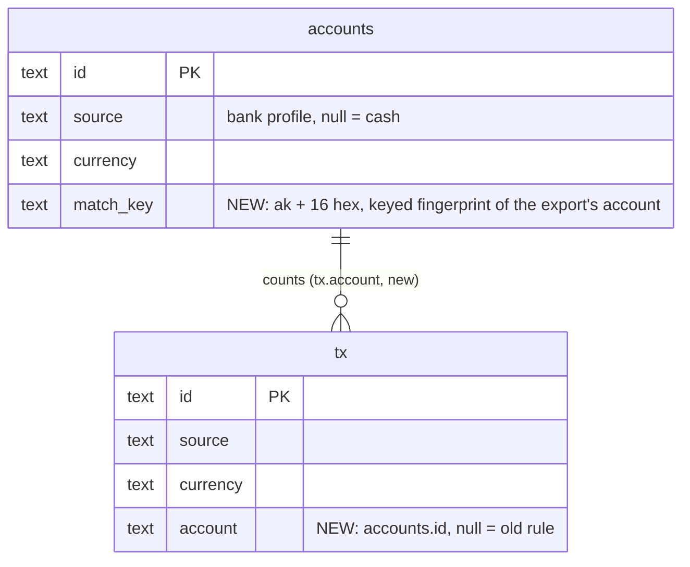

# Schema 21 — payments know their account (draft)

Status: **draft for the owner**, not built. Builds on schema 20 (UX-A core: `accounts.kind`, `accounts.institution`,
`tx.digits`, bill reminder days), which is not on `v2` yet; this draft only adds to it.

## Why

Today a bank row belongs to an account by **(source, currency)**: `_counts` in `accounts.dart` takes every imported
row of the account's source in its currency, and `_checkUnique` allows one live account per (source, currency). So:

- Two accounts at one bank in one currency (PBZ current + PBZ savings, two Revolut pockets) are one app account. Q5
  already works around it (no bank check when a file holds another IBAN or pocket).
- Schema 20's `accounts.kind` / `institution` invite exactly that setup (a savings account next to the current one),
  and it cannot be shown apart.
- An own transfer between two accounts of the same bank never pairs (`planTransfers` needs another source).

The importer already knows the account of each row (`NormalizedTransaction.account`: an IBAN or product name).
Core never stores it, by rule (it names the owner's account). Schema 21 stores **which app account** a row belongs to,
plus a keyed fingerprint that lets every device assign the same file the same way. The IBAN itself is never stored.



## Columns (all nullable, no data migration)

```dart
// 'tx':
    // v21: the app account this bank row belongs to (`accounts.id`), written by importBatch; null = the
    // (source, currency) rule. Never set on hand-added rows.
    ColumnDef('account', nullable: true),

// 'account':
    // v21: `ak:` + 16 hex of HMAC-SHA256(accountMatchKeyKey, normalized export account); null = the main account
    // of its (source, currency).
    ColumnDef('match_key', nullable: true),
```

`schemaVersion` → 21 (the replay on open does the rest). Also: `entityTables` in `test/support/sim.dart`, the
`schema_test` oracle, the doc line in `wallet_core/CLAUDE.md`. Neither column is searchable.

## Rules

**Fingerprint.** `accountMatchKey(VaultKey key, String exportAccount)` (pure, `accounts.dart`): normalize (upper case,
spaces and dashes removed), HMAC-SHA256 with `deriveKey(key, 'bw-account-match-v1')`, `ak:` + first 16 hex. Keyed by
the wallet key, so a database or backup without the key does not reveal the IBAN through a word list (an unkeyed
hash of an IBAN would). Never logged.

**Which account counts a bank row** (`_counts`, `accountBalances`, `checkBankBalance`, `forecast` attribution):
1. `tx.account` names a live account with the row's source and currency → that account.
2. Else the **main account** of (source, currency): the live one with `match_key` null (smallest id if several,
   the existing `duplicateOf` rule); if every live one has a key, the smallest id.

So a row whose account was deleted, or that an older build imported, goes back to the main account and is never
lost from the balances.

**Uniqueness** (`_checkUnique`): one live account per (source, currency, match_key); null is one value (one main
account per bank and currency, as today).

**Import** (`importBatch`): the app passes the fingerprint per row (`ImportBatch` rows gain `accountKey`, computed
with the key the app holds). A new row whose key matches a live account of its source and currency gets
`tx.account` in its creation op; no match → null (main account). A **re-import** of a known id whose stored
`account` is null fills it (only then, never overwrites): re-importing old exports assigns old rows. A file whose
account has no match yet: the app asks once "Which account is this?" (main or new), and setting `match_key` on that
account is a normal owner write.

**Owner move.** `setTxAccount(txId, accountId?)`: an owner write, same source and currency or `ArgumentError`, bank
rows only. For fixing a wrong guess.

**Bank check (Q5).** Recorded per (batch account → app account). The "another IBAN in one app account" skip stays
only for rows that fall to a main account.

## Older builds (accepted, like D2: every device updates together)

- They ignore both columns: rows count by (source, currency) again, and a second live account with that key shows as
  `duplicateOf` (opening only) there.
- Their `updateAccount` on such an account throws (their `_checkUnique`). Nothing is lost; it works after the update.

## Not in schema 21 (follow-ups)

- **Own transfers inside one bank:** `planTransfers` may compare `account` (when both rows have one) instead of
  `source`. Behaviour change in pairing, so its own stage with the two-device transfer tests.
- **`tx.digits` (schema 20, before merge):** if it only covers ISO currencies (JPY 0, BHD 3), a code table
  `currencyDigits(code)` covers every table that has `currency` (bills, ious, accounts) and needs no column; if it is
  for bank-given units ISO does not fix (e.g. Revolut crypto), per row is right. Owner to confirm before UX-A merges.

## Tests (`test/s21_tx_account_test.dart`)

- Two accounts, one source and currency, two keys: rows split by key; balances and `balanceTotals` exact.
- Null / deleted / mismatched `tx.account` → main account; deleting the keyed account moves its rows back.
- Re-import fills a null `account` and never overwrites one; the creation op carries it.
- `accountMatchKey`: normalization, another wallet key gives another key, never in logs (`logs_impl_test`).
- Two devices: same file imported on both → same `tx.account` (no conflict); move on one, sync, both agree.
- Schema 20 → 21 open: replay, nothing rewritten; an old-build device (sim at 20) sees `duplicateOf`, not lost rows.
- Backup round trip keeps both columns (snapshotOps is generic; one assertion).

## Open questions for the owner

1. Ask "which account?" at the first import of a new export account, or default to the main account silently and let
   the owner move it later?
2. Keep `tx.digits` per row (schema 20) or move it to a currency table before UX-A merges?
