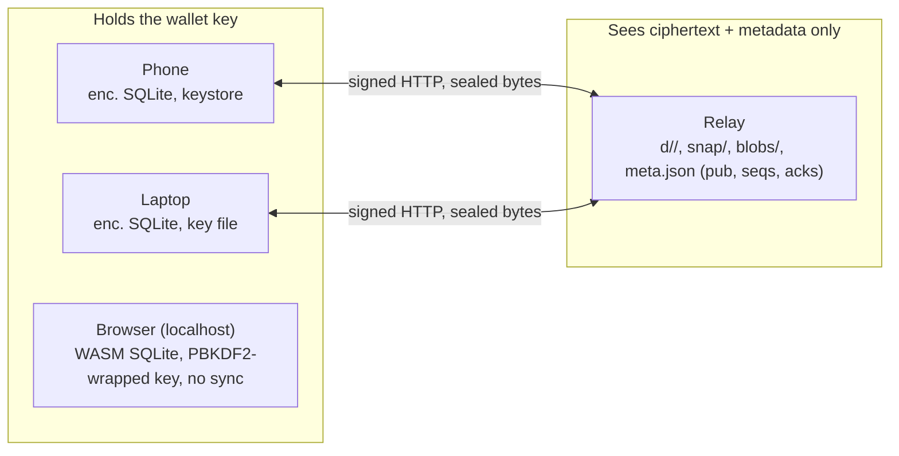

# Budget Wallet — System Architecture Review

Companion to `docs/SYSTEM_DESIGN_REVIEW.md` (§2, §9) and `docs/SECURITY_REVIEW.md`. Written 2026-10-22 against spec
§4, §5 and the "System architecture" checklist in §13. The earlier reviews judged the replication kernel correct
and ranked its edge findings; this pass adds what they did not: a byte-level conformance check of
`docs/context/RELAY_PROTOCOL.md` against the client and the relay, the version numbers that must agree across
components, a per-entity conflict-semantics table, a written safety argument for snapshots and pruning, capacity
limits, a failure matrix, deployment and operations, and decision records with the alternatives considered.
Findings already ranked in the security review are referenced as S-n, not repeated.

## 1. Verdict and checklist answers

The architecture is one secret, one write path, one append-only sequence per device, and a relay that stores
ciphertext and verifies signatures. Every component implements the protocol document exactly; the three checklist
claims hold with the qualifications below.

| §13 item | Answer |
|---|---|
| HKDF labels, file format and signed text match `RELAY_PROTOCOL.md` and `vault.dart` | **Yes, byte for byte** (section 2). The relay tests verify with an independently written signer. |
| Last-writer-wins per field is the right rule for every entity | **For every field, yes; for two field *pairs* and one map-valued setting, no** (section 4): `categoryBudgets`/`merchantPatterns` under one key (S-1 in the system review, finding 1 in security), and status + link pairs (`planned.status`/`paid_tx`, `bill.status`/`linked_tx`) that can split under concurrent writes. |
| Snapshot and pruning cannot lose an op some device has not applied | **Holds for an honest relay** (section 5). A relay restored from an older image or swapped out and back can (S-1). |

## 2. Protocol conformance: document versus code

| Element | Document | Client (`sync_relay.dart`) | Relay | Match |
|---|---|---|---|---|
| Wallet id | HKDF-SHA256(key, salt ∅, info `bw-relay-id-v1`, 16 B) → 32 hex | `relayIdInfo`, `deriveKey(..., length: 16)`, hex | `widPattern ^[0-9a-f]{32}$` | ✓ |
| Signing key | HKDF info `bw-relay-sign-v1`, 32 B seed → Ed25519 | `relaySignInfo`, `newKeyPairFromSeed` | stores `pub` on first `PUT d/<device>/1` | ✓ |
| `pub` encoding | base64url, no padding, 43 chars | `_b64` strips `=` | `decodeBase64Url(s, 32)` requires 43 chars | ✓ |
| Signed text | `bw-relay-v2\nMETHOD\npath\ncovers\nsha256(body)\ntime` | `signedText(...)` identical literal | `signing.dart:signedText` identical literal | ✓ |
| Path in signed text | from `/v2/` on, no query, no prefix | `signedPath` | rebuilt from validated segments | ✓ |
| `X-BW-Time` | ≤ 16 decimal digits | ms since epoch + offset | `_timePattern ^[0-9]{1,16}$`, ± 5 min | ✓ |
| Device / snapshot id | `[A-Za-z0-9_-]{1,64}` | — | `namePattern` | ✓ |
| `seq` | decimal, no leading zeros, ≤ 2^53−1 | `last + 1` | `_seqPattern ^[1-9][0-9]{0,15}$` | ✓ |
| Blob hash | 64 lowercase hex = SHA-256 of body | `fileHash` | `blobHashPattern`, body re-hashed | ✓ |
| Sealed file | `BWOP1 | nonce 24 | tag 16 | ct` of gzip(JSON) | `vault.dart:120, 207-219` | opaque | ✓ |
| Local DB key | HKDF info `bw-local-db-v1` | `local_db.dart:13` | n/a | ✓ |
| Status codes | 200/201/204/400/401/404/405/409/410/413/422/429/507 as tabulated | handled per `TransportFailure` | `relay_server.dart:226-282` and handlers | ✓ (sampled) |
| Clock offset rule | from `Date` on 401 `clock`, retry once, |offset| ≤ 24 h | `sync_relay.dart:184-200` | `Date` on every answer | ✓ |

Two observations rather than mismatches. The schema version of a snapshot travels in its *id*
(`s<schema>-<ms>-<random>`, `sync_engine.dart:647`), which the relay can read and which is not authenticated; a
relay cannot forge a snapshot but can present an old one under a new id, which the missing associated data (S-9)
would otherwise catch. And the document's threat model does not mention the relay-identity gap; add it when S-1 is
fixed, since that fix is a protocol change (`GET state` gains an instance id).

## 3. Version numbers that must agree

| Constant | Value | Where | Changes when | Who notices |
|---|---|---|---|---|
| Relay API | 2 | `relayApi`, `/v2/`, `{"api":2}` | endpoint semantics change | client: `newerApi` / `olderApi` with a user message |
| Sealed-file magic | `BWOP1` | `vault.dart:120` | the sealed layout changes (S-9 would make it `BWOP2`) | `unseal`: `newerFormat` → file quarantined until upgrade |
| Payload version | 1 | `backupVersion`, `"v"` inside snapshots and backups | the JSON op envelope changes | backup restore refuses newer; snapshots carry it too |
| Sync reader version | 1 | `syncReaderVersion` | how a file's ops are read | part of the `build` string that decides when to retry a quarantined file |
| Schema version | 7 | `WalletRepo.schemaVersion` | an entity or synced field is added | cursors cleared once on upgrade → replay; snapshot id tag decides "of this schema or newer" |
| App version | from pubspec | `appVersion` | every release | in the `build` string only |

Compatibility rules as implemented: an older build ignores entities and fields it does not know
(`_apply` skips unknown columns without recording the clock, `repo.dart:242-245`), so mixed versions converge on the
fields both know and the older build replays once after upgrading; a newer file *format* (magic) is quarantined, not
corrupting; a newer relay API stops sync with a message; a snapshot from an older schema is used only when a pruned
file leaves no choice. This is a coherent scheme. Two gaps: the six numbers are documented in five files and nowhere
together (put this table in the spec), and there is no test that a schema-6 build reading schema-7 files behaves as
described (the convergence test runs one build). "Upgrade all devices together" in §11 is the honest current policy.

## 4. Conflict semantics per entity

Rule: per field, highest hybrid logical clock wins; `deleted` is a field; rows are created only when some field
applies; ids are deterministic where two devices can discover the same thing.

| Entity | Fields | Concurrent-write cases | Result | Verdict |
|---|---|---|---|---|
| `tx` | source, date, amount, currency, bank_type, description, category, note, manual, matched_to, deleted, seen_bank, kind_hint, transfer_to | A sets category, B sets note | both win | right |
| | | A deletes, B edits category | deleted with the new category; import never writes `deleted: 0` so re-import cannot resurrect | right, intentional |
| | | A and B both match/pair after catch-up | same deterministic result, converges by recomputation | right while deterministic; assert zero ops on a second round |
| `goal` + `goal_contrib` | saved written once; contributions are rows | A adds 50, B adds 30 offline | both count | right (better than Actual's raw LWW) |
| `wish` | name, price, added, status, decided | A buys, B skips | later status wins; `decided` from the same op | acceptable |
| `setting` | value (JSON) per key | different keys | both win | right |
| | | `categoryBudgets` map: A sets Groceries, B sets Rent | one map replaces the other, a budget vanishes | **wrong**; one row per category |
| | | `merchantPatterns` list | same | **wrong**; one row per pattern |
| `rule` | category per merchant | A "always Groceries", B "always Eating out" | later wins | right |
| `recurring` | payee, label, category, expected_amount, interval_days, next_due, status, last_paid_tx | A confirms, B dismisses | later status wins; creation op carries no status so a late detection cannot undo a decision | right, thoughtful |
| | | A skips cycle (next_due), B marks paid (next_due + last_paid_tx) | field-wise mix: later next_due, B's last_paid_tx | tolerable; read side should derive from the payment |
| `planned` | title, date, amount, category, source, source_ref, status, paid_tx | A marks paid (status + paid_tx, one op), B skips (status only) | if B's clock is later: `status = skipped` with `paid_tx` still set | **split pair**; readers must treat `paid_tx` as meaningful only when `status == paid`, and the simulation should assert it |
| | | calendar event dismissed on A, amount set on B | same id (`calendar:<ref>`), later field wins per field | right |
| `bill` | 22 fields incl. status, linked_tx, blob | A links payment X, B links payment Y to the same bill | later wins, one payment | right |
| | | A links bill 1 to tx T, B links bill 2 to tx T | two bills share one payment; "one payment per bill" is checked locally only (`repo.dart:1387`) | **no repair**; add the caught-up repair transfers and matches already get |
| | | A confirms (status), B deletes | deleted wins by field, status irrelevant | right |
| blobs | outside the op log; own outbox, delete queue, own-set, cache | same file imported on two devices | one orphan upload until the next caught-up run cleans it | documented; see decision record 6 |

The pattern behind the two wrong rows is the same: a *set* or *pair* modelled as one value. Everything modelled as
one field per fact converges correctly.

## 5. Snapshots and pruning: why no live device loses an op

Definitions. A device D writes files `D/1..last_D`. A snapshot S carries `covers_S[X]` for every device X and is
written only by a device that is caught up (`sync_engine.dart:483-485`), with `covers_S[X]` = its cursor for X and
`last_D` for itself (`:757-761`); the snapshot content is the full state after applying through those cursors, so it
contains at least every op it claims. The relay keeps the latest snapshot and the previous one. It prunes `X/seq`
only when `seq ≤ covers[X]` for every kept snapshot **and** `seq ≤ acks[X]` for every other device seen within 90
days (`wallet.dart:143-169`).

Claim. A device E that is not partitioned for more than 90 days can always obtain every op either as a file or
inside a kept snapshot.

Argument. Take any op in `X/seq`. Case 1: E has acked it; then E applied it, done. Case 2: E has not acked it and E
was seen within 90 days; then the ack condition fails and the file is kept. Case 3: E was not seen for 90 days; the
file may be pruned, but it is pruned only if both kept snapshots cover it, and E's next run finds `cursor + 1 <
first` and bootstraps from the latest snapshot (falling back to the previous), which by construction contains the op
(`:402-412`). The relay accepts a new snapshot only if its covers dominate the current one's, so the kept snapshots
never regress, and it keeps two so that a device mid-download of the latest can still fall back. A device with a
quarantined file never writes a snapshot that claims to cover it because it is not caught up. **Holds.**

What the argument assumes, and where the security review found the assumptions broken: an honest relay that never
loses or rewinds state (S-1: a restored or swapped relay violates this silently); one install per device id (S-2: a
clone breaks "E has acked it ⇒ E applied it" because the twin acked); sane clocks (S-3 does not break pruning but
breaks the meaning of the timestamps the merge relies on). None of these is a flaw in the pruning rule; they are
flaws in the identity the rule relies on.

## 6. Capacity and limits

| Limit | Value | Source | Headroom for the stated user |
|---|---|---|---|
| Sealed file | 16 MiB; uploads split at 8 MiB parts | relay, `maxPartBytes` | A month of edits is kilobytes; only a first full-state upload approaches this |
| Snapshot | 64 MiB | relay | 20,000 rows ≈ 3–4 MB JSON before gzip (one op per row, ~150 B); ~1 MB sealed. Decades of headroom |
| Snapshot cadence | 7 days or 500 ops behind | `snapshotAge`, `snapshotOpsBehind` | Fine; a snapshot costs a full `snapshotOps()` read, logged if over 1 s |
| Blob | 15 MiB plain (ArgumentError above), 16 MiB sealed | `blob_store`, relay | A phone photo is 2–5 MB; a scanned PDF under 1 MB |
| Wallet on relay | 1 GiB (files + kept snapshots + blobs) | `--max-bytes` | ~300 photos at 3 MB; the first real constraint a bills-heavy household meets in 2–3 years. Make it visible in Plan › Sync |
| Wallets per relay | 16 | `--max-wallets` | Fine for a household; the creation-token fix (S-4) is what protects it |
| Rate | 20 req/s per address, burst 100; 32 MiB in flight per address | relay | Fine on a LAN; collapses behind a proxy (S-8) |
| Relay memory | bodies fully buffered, single isolate | design | 64 MiB per snapshot upload; acceptable on a home server, not on a 512 MB VPS with several wallets |
| Local DB | SQLite, indexes on `tx.date`, `tx.amount`, `planned.date`, `bills.date`, `bills.linked_tx`; `clocks` keyed (entity, id, field) | schema | 20,000-row perf test passes; `_apply` does one `clocks` lookup per field per op, the hot path on a replay from empty |
| Blob cache on device | LRU by bytes | `BlobStore.maxCacheBytes` | Evicted documents are relay-only (system review §2.1) |
| Search | in-memory linear fold | `search.dart` | Fine at 20k rows; FTS only if it ever exceeds ~200k |

## 7. Failure matrix

| Event | Behaviour | Recovery | Verified by |
|---|---|---|---|
| Relay unreachable | App works; outbox grows; sync status shows the error | Next successful run sends everything | tests + design |
| Relay wiped | `relayLast < marker` → full-state re-upload from each device | Automatic | tests |
| Relay restored from older image | Marker trusts seq numbers → ops uploaded in between are silently skipped | **None** until S-1 | reasoning, no test |
| Relay swapped A→B→A | Same as above | **None** until S-1 | reasoning, no test |
| One peer file damaged | Quarantined by content hash; that peer's later files wait; others continue | A caught-up device writes a heal snapshot after 24 h | tests |
| Device offline > 90 days | Its files may be pruned; it bootstraps from a snapshot | Automatic | tests |
| Device cloned (backup, copied dir) | Two installs, one id; 409 on each other's seqs, retried silently | **None** until S-2 | reasoning, no test |
| Device with clock far ahead | Its clocks win; every device's HLC advances permanently | **None** until S-3 | convergence test proves convergence, not sanity |
| App upgraded on one device first | Newer fields ignored by old builds; old build replays once after upgrade | Automatic | design; no mixed-build test |
| App downgraded | Newer magic → `newerFormat` quarantine; newer api → message | Upgrade again | tests for magic |
| Key lost on every device | Unrecoverable by design | Backup `.bwb` + key in a password manager | design |
| Phone lost with key | Attacker holds the wallet key; no revocation | Rotate by hand: backup → new key → restore → re-point devices (document, S-6) | — |
| Blob evicted locally, relay down | Document unavailable until relay returns | Automatic later | design |
| Web tab frozen before flush | Last ≤ 800 ms of edits may be lost | Inherent to IndexedDB VFS | design |

## 8. Deployment and operations

Topology as deployed: one relay container (`dev/Containerfile.relay`, AOT binary, non-root, `/data` volume) under a
Podman quadlet with `Restart=always`, reached over LAN or Tailscale/WireGuard; devices hold the full state. This is a
sound home-server shape. Operational gaps, none of them deep:

- **Backup of the relay**: documented as "copy the data folder"; the folder is only sealed files plus `meta.json`,
  and losing it is survivable (devices re-upload). Fine. Say explicitly that a *restore from an old copy* is the one
  dangerous operation (S-1) until the instance id lands.
- **Observability**: one log line per request with kind, status, bytes and short ids; `/v2/health` returns the API
  version only. Add a `HEALTHCHECK`, and consider a signed `GET state` based status page in the app (it already shows
  devices and last-seen). No metrics endpoint is needed for one household.
- **Upgrades**: relay rebuild + restart is documented; app upgrades should be "all devices within a week" and the
  schema-bump replay should be mentioned in the release notes template.
- **TLS**: plain HTTP with VPN recommended; ship TLS as the default path (S-7).
- **Relay sizing**: single isolate, buffered bodies; fine for 16 wallets on a home box.
- **Disaster drill**: nothing in the repo exercises "new phone, relay alive" or "new phone, relay dead, backup file"
  end to end on a device. Add both to the owner's M6 checklist.

## 9. Diagrams

Topology and trust boundary:



One sync run (`SyncEngine.run`):

```mermaid
sequenceDiagram
  participant D as Device
  participant R as Relay
  D->>R: GET state
  D->>R: PUT blob/<hash> (queued bill files)
  D->>R: PUT d/<me>/<last+1> (outbox, ≤8 MiB parts; full state on first contact)
  Note over D: outbox cleared only after every part stored
  loop each peer, strictly in seq order from cursor
    D->>R: GET d/<peer>/<seq>
    Note over D: unseal → type-check → apply per field by HLC; damaged → quarantine by content hash
  end
  D->>R: PUT ack/<me> {peer: cursor}
  D->>R: DELETE blob/<hash> (queued deletes)
  alt caught up
    Note over D: run matching + pairing once; write snapshot if 7 d or 500 ops behind; heal a stuck peer after 24 h
    D->>R: PUT snapshot/<s7-ms-rand> (X-BW-Covers)
  end
```

## 10. Decision records (what was chosen, what was not, verdict)

1. **Dumb relay with E2E sealed per-device sequences** over a server that merges (Firefly, YNAB), a sync server
   with schema knowledge (PowerSync, ElectricSQL), SQLite-level CRDT replication (cr-sqlite), or peer-to-peer
   (Syncthing). Keeps the relay content-blind and ~1,200 lines; costs client-side merge logic and the identity gaps
   above. **KEEP.** cr-sqlite would collide with `sqlite3mc` and WASM; the hosted options break the privacy promise.
2. **Per-field LWW with hybrid logical clocks** over per-row LWW, Automerge/Yjs, or server timestamps. Same choice
   as Actual Budget; correct for flat ledger rows; wrong for sets under one key. **KEEP**, with the per-key fix.
3. **One wallet key, HKDF children** over per-device keys with an enrolment ceremony (Syncthing certificates,
   Bitwarden device sessions). Zero key management for the owner; no revocation. **KEEP for one owner; document
   rotation; plan per-device signing keys as the first multi-key step.**
4. **Snapshots + ack-gated pruning** over keeping history forever or a merkle-trie catch-up (Actual). Bounded relay
   storage with a provable no-loss rule under an honest relay. **KEEP.**
5. **Deterministic ids for discovered things** (`rec:<payee>`, `calendar:<ref>`, `bill:<hash>`) over coordination.
   Right tool; collision domains should be documented. **KEEP.**
6. **Blobs outside the op log** (content-addressed, own queues, LRU cache) over inlining or an attachments service.
   Right to keep 16 MiB out of op files; the four bookkeeping tables are a second replication system with their own
   orphan cases. **KEEP the storage, CHANGE the invariants**: upload-before-ack, never deleted by clients, server-side
   GC from hashes referenced by kept snapshots.
7. **SQLite + `sqlite3mc`, raw SQL, no ORM** over drift/Isar/Hive. Native and WASM from one code path, encryption
   at rest, one write path. **KEEP; pin the cipher.**
8. **Web as a full client without sync** over no web, or web with sync. Costs a third storage stack for a
   localhost-only use. **Park it or finish it** (the relay client is pure Dart and compiles to WASM).
9. **Signed requests with TOFU on creation** over bearer tokens (v1, never deployed) or mutual TLS. Right for one
   owner; needs the creation token (S-4) and a visible relay fingerprint.
10. **Plain HTTP + VPN** over built-in TLS. Honest for a home LAN; wrong as the documented default (S-7).

## 11. Recommendations specific to this layer

Already ranked in the security review: S-1 relay instance id, S-2 device id per install, S-3 bounded HLC, S-4
creation token, S-9 associated data with `BWOP2`, S-10 pin the SQLite cipher. In addition, from this pass:

1. Put the version table (section 3) in the spec and add a mixed-build test: a schema-6 reader applying schema-7
   files, then upgrading and replaying.
2. Add field-pair invariants to the two-device simulation: `planned.paid_tx != null ⇒ status == paid`;
   `bill.linked_tx` unique across live bills; transfer pairs symmetric; `ack ≤ cursor ≤ last`; `covers ≤ cursors`.
3. One settings row per category budget and per merchant pattern (the only wrong rows in section 4).
4. Add the relay-identity and clone adversaries to the protocol document's threat model when S-1 and S-2 land, and
   bump the document's decision date.
5. Show relay usage against the 1 GiB limit in Plan › Sync; it is the first capacity wall a bills-heavy household
   reaches.
6. Add two disaster drills to M6: new phone with the relay alive; new phone with the relay dead and a `.bwb`.
7. Document the schema-bump replay in a release-notes template and the "all devices within a week" policy.
